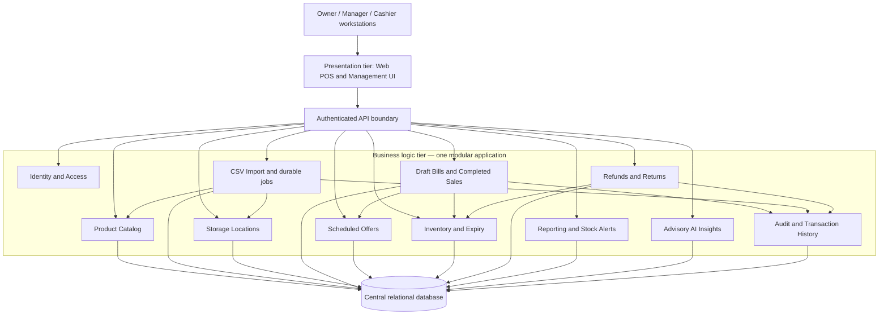

# Product Requirements Document

**Project:** AI-Powered Smart POS and Inventory Management System  
**Document:** Product Requirements Document  
**Version:** 3.1  
**Date:** 15 November 2026  
**Scope:** 16 functional requirements (FR-01–FR-16), 4 non-functional requirements (NFR-01–NFR-04), associated business rules, acceptance criteria, and remaining implementation decisions.

## 1. Product / Feature Overview

The AI-Powered Smart POS and Inventory Management System is intended for one retail shop and combines in-store billing, inventory visibility and updates, CSV product import, product shelf/storage location management, scheduled store-wide Authorized Offers, product expiry tracking, sales reporting, stock alerts, and advisory AI recommendations. Its intended users are the Business Owner, Store Manager, and Cashier, with access limited by role. The system supports product lookup by barcode scan, manual barcode entry, or product-name search. A sale is recorded as a **Completed Sale** only when the bill is pushed after the customer’s payment has been received and checked outside the POS. An unpushed **Draft Bill** is not a completed transaction and does not deduct stock. The POS does not process payments or connect to payment providers. The system is intended to reduce the time and effort spent monitoring stock and interpreting sales information. It should show recorded facts and explain the evidence behind AI Recommendations without inventing missing data or making the final purchasing decision. The Business Owner retains that decision. **Requirements baseline:** The product scope consists of 16 functional requirements and four prioritized non-functional requirements. FR-14–FR-16 implement the three newly supplied capability groups. Unspecified details are referenced under Section 14.

## 2. Problem and User Need

The retail shop owner currently needs to spend time monitoring stock, checking expiry dates, and interpreting sales information while also operating the shop. This manual effort competes with serving customers and makes it harder to notice products needing attention. The user needs a system that brings billing, inventory records, expiry information, sales analysis, and stock-related notices together. The Business Owner and Store Manager need useful information about products that may be low in stock, out of stock, approaching expiry, fast-selling, or slow-moving. They also need controlled bulk product import, visibility into each product’s storage location, and automatic application of Authorized Offers only during their scheduled active periods. They also need understandable AI Recommendations based on available evidence. Recommendations must communicate uncertainty and must not replace the Business Owner’s purchasing judgment. The system also needs to support eligible in-store returns and refunds while preserving links to the original sale and keeping sale, refund, and inventory records consistent. Role-based access is needed so that the Business Owner, Store Manager, and Cashier can perform their assigned activities without giving the Cashier access to protected inventory-maintenance, analytics, or AI Insights functions.

**Supporting sources:** Step 3 §§3.1–3.4; Decision Log Q1–Q3, Q11–Q24, Q25–Q48.

## 3. Goals

### 3.1 User-level goals

1. Complete daily in-store billing using barcode scanning, manual barcode entry, or product-name search.
2. Keep recorded stock updated after Completed Sales and eligible returns, subject to the unresolved returned-stock timing rules.
3. Identify products that are out of stock and, once the criteria are agreed, low in stock or approaching expiry.
4. Record expiry dates manually when incoming stock arrives.
5. Understand recorded sales quantities, trends, and profitability without reviewing every transaction manually.
6. Receive explained, advisory AI Recommendations that distinguish known facts from uncertain conclusions.
7. Process eligible full or partial refunds and maintain traceable transaction records.
8. Allow the Business Owner, Store Manager, and Cashier to perform only their assigned activities.
9. Reduce manual effort spent monitoring inventory and interpreting sales records.
10. Import valid new or existing products from CSV with preview, duplicate resolution and recoverable processing.
11. Find products by their current storage location and maintain locations without changing product registration or stock.
12. Ensure an Authorized Offer is active only within its scheduled time window and is reflected in billing without Cashier schedule control.

### 3.2 Product goals

1. Support quick and correct in-store billing.
2. Keep sale records and corresponding inventory changes consistent.
3. Display recorded stock quantities and relevant Stock Alerts.
4. Support manual expiry-date entry by an Authorized Inventory User.
5. Present sales and product-performance information while keeping sales volume separate from profitability.
6. Provide evidence-based, advisory recommendations without presenting unsupported predictions as certain.
7. Maintain refund, transaction, and audit records that support traceability.
8. Enforce role-based access for the three defined roles.
9. Reduce the effort required to review product and sales information.
10. Provide role-controlled CSV import with clear validation, Replace/Skip decisions, an explicit confirmation step and a final outcome report.
11. Keep each Registered Product associated with at most one existing storage location and support safe deletion and filtering.
12. Support non-overlapping scheduled store-wide offers with automatic activation, expiration, and authorized editing.

The updated Decision Log gives the priority order **worker access, expiry, analytics** for the previously discussed capabilities. No measurable target for reduced workload has been established.

**Supporting sources:** Step 3 §§3.2–3.4; Decision Log Q1–Q10 and Q49–Q68.

## 4. Non-Goals / Out of Scope

The following are outside the agreed project scope:

- Online ordering or an e-commerce platform.
- Customer or supplier delivery tracking.
- Supplier management, supplier ordering, purchase-order creation, or automatic purchasing.
- Direct payment processing or payment-provider integration.
- Customer accounts or loyalty schemes.
- Support for multiple retail branches.
- AI making final business or purchasing decisions on behalf of the Business Owner.
- CSV import does not import or adjust stock quantities.
- Storage-location history is outside the new location-management scope.
- A Scheduled Authorized Offer cannot be restricted to selected products and cannot overlap another offer’s scheduled time window.
- The system is for in-store retail transactions at one shop.
- External payment is handled outside the POS and checked by staff before the bill is pushed.
- The project does not include a pending-sale or stock-reservation workflow.

**Supporting sources:** Step 3 §3.5; Decision Log Q3–Q8 and updated Q36.

## 5. Users and Stakeholders

| User / stakeholder | Responsibilities and access recorded in the sources | Limits / status |
|---|---|---|
| **Business Owner** | Responsible for the shop; has full system access; can bill, manage products and inventory, import CSV products, view/change/organize storage locations, create/edit/schedule/cancel store-wide offers, set prices, view analytics and AI Insights, view audit records, manage user accounts and reset passwords; makes final purchasing decisions. | The ability to delete Audit Records is recorded in one member’s notes but requires explicit product specification and retention safeguards (OQ-04). |
| **Store Manager** | Can bill, manage products and inventory, import CSV products, manage storage locations and product assignments, create/edit/schedule/cancel store-wide offers, make Manual Stock Adjustments, set prices, and view reports, Stock Alerts, AI Insights, and Audit Records. Can enter expiry information as an Authorized Inventory User. | Cannot create/manage user accounts or reset passwords. Can change product prices when using a Store Manager account. Other permission details remain open (OQ-02). |
| **Cashier** | Can perform billing, scan/search products, push a bill after externally received payment, and submit eligible refunds. The Business Owner, Store Manager, and Cashier are all permitted to Push paid Draft Bills. | Cannot import CSV products, change or manage storage locations, create/edit/schedule/cancel offers, manually adjust inventory, change product prices, create discounts, or access analytics, AI Insights, or Audit Records. Can view a product’s storage location when looking it up. |
| **Customer** | Presents products for in-store purchase and may present a Receipt and Returned Products for an eligible refund. | No customer account or loyalty functionality is in scope. |

There are exactly three system roles: Business Owner, Store Manager, and Cashier. “Authorized Inventory User” is a glossary term for the Business Owner or Store Manager, not a fourth role.

**Supporting sources:** Step 4 “Users and access”; Decision Log Q11–Q24, Q37–Q48.

## 6. Ubiquitous Language / Glossary

The following terminology is used consistently throughout this specification. Details not defined in the requirements baseline are referenced under Open Questions.

| Term | Definition |
|---|---|
| **Business Owner** | Person responsible for the retail shop, with full system access and final purchasing authority. |
| **Store Manager** | User who can perform billing, manage products and inventory, set prices and offers, view reports and AI Insights, and view audit records, but cannot manage user accounts. |
| **Cashier** | User responsible for checkout and eligible refunds; cannot manually adjust stock, change product prices, create discounts, or view analytics and AI Insights. |
| **Authorized Inventory User** | The Business Owner or Store Manager; not a separate role. May enter or adjust inventory information, including expiry dates. |
| **Registered Product** | A product entered into POS product records so staff can identify it during billing; it may have one Storage Location or be Unassigned. |
| **CSV Product Import** | Authorized bulk creation or updating of Registered Products from a `.csv` file containing the exact four-column header `product_name,barcode,selling_price,storage_location`, with optional row-level Storage Location values. |
| **Import Preview** | Pre-commit view of new products, existing-product matches, invalid rows, duplicate Barcode groups, and required user decisions. |
| **Replace / Skip** | Choices for a valid imported row matching an existing Registered Product by Barcode: Replace writes the four CSV product fields (including an optional location, potentially Unassigned); Skip leaves the existing product untouched. Neither changes stock quantity. |
| **Storage Location** | Named shelf or storage place to which at most one current assignment per Registered Product is permitted; deletion makes associated products Unassigned. |
| **Unassigned Storage Location** | A Registered Product has no current Storage Location. This is allowed, including when the optional CSV location is absent. |
| **Location Normalization** | Canonicalization of equivalent capitalization and minor formatting variations (e.g., `Shelf A-01`, `shelf a-01`, `Shelf A 01`) without autocorrecting genuine spelling differences. |
| **Barcode** | Code used to look up a Registered Product. Manual barcode entry and product-name search are also supported. |
| **Inventory** | System records of products and stock quantities, updated after Completed Sales and through authorized changes. |
| **Recorded Stock** | Quantity shown in inventory records. It may differ from physical stock if a change was not recorded; correction procedure remains open. |
| **Available Stock** | Units eligible to be sold; returned units not confirmed Resellable must not be included. Returned units not confirmed Resellable are excluded; detailed reconciliation with Recorded Stock and batch balances remains under OQ-34. |
| **Manual Stock Adjustment** | Change to Recorded Stock made by the Business Owner or Store Manager rather than by an automatic sale/return update. |
| **Product Batch** | Units of the same product received together and tracked separately with their own quantity, Expiry Date, and purchase cost per unit. |
| **Expiry Date** | Date manually entered by an Authorized Inventory User for a product or incoming batch. |
| **Approaching Expiry** | Product or batch close enough to its Expiry Date to need attention. The warning period is unresolved. |
| **Low Stock** | Condition in which Available Stock is at or below the manually configured product-specific threshold. The system may also present an AI-suggested threshold, which is advisory and does not replace the manual threshold unless accepted by an authorized user. |
| **Out of Stock** | Product with no Available Stock recorded. |
| **Stock Alert** | Notice identifying stock needing attention, including Low Stock, Out of Stock, or Approaching Expiry. Triggers and priority rules remain unresolved. |
| **Draft Bill** | Bill being prepared that has not been pushed as a Completed Sale. It is not in Completed Sale history and does not change Inventory. |
| **Completed Sale** | Sale recorded when the Cashier pushes the bill after receiving and checking payment outside the POS. Related stock is deducted. “Pushed Bill” refers to the checkout action. |
| **Payment Verification** | Staff check that payment was received outside the POS. The POS does not collect or process money. |
| **Receipt** | Proof of sale that must match an existing, verifiable transaction record before a refund can be accepted. |
| **Refund** | Reversal of an eligible in-store sale or part of one. The Cashier may process an eligible Refund independently within 168 hours of the original purchase time. |
| **Partial Refund** | Refund for only some items or quantities from an original sale. Refunding the same returned units twice is not permitted; the remaining refundable amount calculation is unresolved. |
| **Pending Refund** | Refund recorded in the POS while the actual money has not yet been returned outside the system. Status-transition steps are unresolved. |
| **Completed Refund** | Refund for which the external return of money has been confirmed. Who confirms it and how status is updated remain unresolved. |
| **Returned Product** | Product physically brought back by a customer. A recorded return does not automatically make it available for resale. |
| **Resellable Product** | Returned product confirmed suitable for resale. Only confirmed resellable units may be added to Available Stock; the condition-check workflow is unresolved. |
| **Transaction History** | Records of Completed Sales and linked Refund activity. Unpushed Draft Bills are not Completed Sales. A Draft Bill is persisted only when the Cashier clicks Save; unsaved drafts are lost if the system crashes. Draft-cancellation history is not a required capability in the current scope. |
| **Sales Report** | View of recorded sales information for an agreed reporting period. Weekly, monthly and custom periods are listed as options; the required reporting periods remain unspecified (OQ-16). |
| **Sales Trend** | Change in recorded sales activity over time. Comparison periods and calculation method are unresolved. |
| **Product Demand** | How much and how frequently a product sells according to recorded sales information. High, average, low, and insufficient-data criteria are unresolved. |
| **Profit / Profitability** | Financial measure based on sales and product cost. Units sold and profit are different measures; exact formula is unresolved. |
| **AI Recommendation** | Advisory suggestion using available sales and stock evidence to explain why a product needs attention. The Business Owner makes the purchasing decision; proposed quantity and correctness tests are unresolved. |
| **AI Insights** | User-facing view in which authorized roles review AI Recommendations; not a separately agreed forecasting capability. |
| **Dashboard** | User-facing summary of recorded shop information; the required figures remain open (OQ-42). |
| **Authorized Offer** | Store-wide, non-product-restricted discount configured by the Business Owner or Store Manager; it has a Percentage Discount or Fixed-Amount Discount and may be scheduled or active. Detailed tax/rounding/application-base rules remain open (OQ-31, OQ-50). |
| **Scheduled Authorized Offer** | An Authorized Offer with configured start and end date/time. It is active from the start instant until the end instant, and cannot overlap another scheduled offer. |
| **Percentage Discount** | Authorized Offer with a percentage value, applied to all products under the agreed bill calculation rules. |
| **Fixed-Amount Discount** | Authorized Offer with a monetary discount amount, applied store-wide under calculation rules not yet fully established (OQ-50). |
| **Insufficient Data** | Available product information or sales history does not support a reliable conclusion. Known facts should be shown without inventing missing values or confident demand predictions. |
| **Audit Record** | Record of a sensitive action, including user identity, timestamp, action, and relevant previous/new values. Retention and deletion safeguards remain unresolved. |

### Terminology conventions

- Use **Draft Bill** and **Completed Sale**, not “Pending Bill” or “Reserved Stock.” The latest update excludes a pending-sale and stock-reservation workflow.
- **Inventory**, **Recorded Stock**, and **Available Stock** refer to related but not yet fully reconciled quantities; do not substitute one for another until OQ-34 is resolved.
- **AI Insights** names the user-facing view for **AI Recommendations**, rather than an additional agreed AI capability.
- **Push** is the action that records a paid sale. Save is an explicit action: the Draft Bill is persisted only when the Cashier clicks Save; an unsaved Draft Bill is lost if the system crashes.
- CSV imports require an exact four-field **header**, but the fourth **value** (`storage_location`) is optional per row; do not interpret the older “all four fields mandatory” statement as the final rule.
- Treat an Authorized Offer as **store-wide** even where a high-level original requirement mentions “applicable products.” Each Scheduled Authorized Offer uses date **and time**, and only one offer may cover a given instant.
- Use **168 hours from the original purchase time**, not seven calendar days.
- Distinguish a Returned Product from Available Stock and a Pending Refund from a Completed Refund.
- Distinguish sales quantity from Profitability and recorded facts from estimates.
- The Decision Log says the system is intended to run on a LAN and not be publicly available in the context of password policy, but the full hardware/network deployment conditions remain unspecified (OQ-27).

**Supporting source:** Step 4 “Ubiquitous Language” and “Terminology issues found during review.”

## 7. Functional Requirements

The 16 functional requirements below define the product scope. FR-01–FR-13 cover the core shop capabilities; FR-14–FR-16 specify CSV Import, Storage Location Management and Scheduled Authorized Offers. Each requirement includes its source and references to any separately identified specification gaps.

### FR-01 — User authentication and role-based access

**Requirement:** The system shall require a user to log in when the system starts and shall grant access to functions according to the assigned role. It shall deny operations for which the role lacks permission. The Business Owner shall be able to create and manage system-user accounts and reset passwords, as recorded in Decision Log Q12. CSV import, storage-location management, and scheduled-offer permissions are defined separately under FR-14–FR-16; other unspecified access rights remain under OQ-02.

- **Actors:** Business Owner, Store Manager, Cashier.
- **Recorded behavior:** Business Owner manages user accounts and resets passwords; Store Manager cannot manage accounts; Cashier cannot manually adjust stock, change prices, create discounts, or access analytics, AI Insights, or Audit Records.
- **Supporting source:** Decision Log Q11–Q24 (including updated Q23–Q24); Step 4 “Users and access.”
- **Status:** Core access rules recorded; complete permission matrix and inactive-session security sign-off **Open — see referenced OQ**.

### FR-02 — Product registration and product lookup

**Requirement:** The system shall allow the Business Owner and Store Manager to maintain Registered Products. Manual product registration requires Product Name, Barcode, Selling Price, and Category; other product fields are optional unless specified elsewhere. Authorized checkout users can locate products by scanning a Barcode, entering it manually, or searching by product name. Purchase cost is recorded separately for each incoming Product Batch under FR-05/FR-06; CSV product creation and updates remain separate under FR-14 and do not update stock quantities.

- **Actors:** Business Owner and Store Manager for product maintenance (exact registration permissions require confirmation); Business Owner, Store Manager, and Cashier for checkout lookup.
- **Supporting source:** Decision Log Q25–Q26; Step 4 “Registered Product” and “Barcode”; Step 6 FR-02.
- **Status:** Lookup methods and unknown-barcode fallback to name search are recorded. Manual registration requires Product Name, Barcode, Selling Price, and Category. The CSV-specific fields, role permissions, and duplicate resolution are **Defined in FR-14**. A product not found by Barcode or name must not be invented; the user is informed that no matching product exists.

### FR-03 — Prepare an in-store Draft Bill

**Requirement:** The system shall allow a permitted checkout user to prepare a Draft Bill by adding Registered Products and quantities, displaying recorded selling prices and calculating the bill amount using authorized discounts/offers. The Business Owner and Store Manager may configure these offers; a Cashier cannot create discounts or independently reduce the amount. Scheduling, store-wide applicability, offer activation and role permissions are specified in FR-16. Monetary calculation/rounding and possible non-scheduled-discount exceptions remain unresolved (OQ-10, OQ-31, OQ-50).

- **Actors:** Business Owner, Store Manager, Cashier.
- **Supporting source:** Decision Log Q15–16 and Q25–36; Step 4 “Draft Bill”; Step 6 FR-03.
- **Status:** Core billing capability retained. Under FR-16, only an offer active at the relevant billing instant can affect a Draft Bill or final bill. The one-offer-at-a-time rule is defined; other stacking exceptions and Save/Confirm semantics remain open.

### FR-04 — Record a Completed Sale

**Requirement:** The system shall validate sufficient Available Stock when a user pushes a paid Draft Bill. If any requested quantity exceeds Available Stock, the system shall reject the sale without recording a Completed Sale or deducting stock. Stock validation, Completed Sale creation, and stock deduction shall occur atomically in one database transaction. Concurrent pushes for the last available unit shall be serialized or protected by an atomic conditional update so that only one succeeds; a losing cashier shall see: ‘This product is currently being sold in another transaction. Please refresh the stock and try again.’ The Draft Bill remains unchanged for manual quantity adjustment and retry.

- **Actors:** Business Owner, Store Manager, and Cashier; all three roles may Push a paid Draft Bill.
- **Supporting source:** Updated Decision Log Q30–36; Step 4 “Payment Verification” and “Completed Sale”; Step 6 FR-04.
- **Status:** Defined. Unpushed bills do not deduct stock. A successful Push atomically records the sale and deducts stock once; insufficient-stock and concurrent last-unit behavior are defined above. Crash-recovery details beyond transaction atomicity and idempotent retry remain subject to NFR-02/OQ-24.

### FR-05 — Inventory management and Manual Stock Adjustments

**Requirement:** The system shall display Recorded Stock and allow the Business Owner or Store Manager to make Manual Stock Adjustments, keeping those actions distinguishable in records from sale/return-driven stock changes. When Recorded Stock and physical/Available Stock disagree, the system shall present the discrepancy and allow the Business Owner or Store Manager to choose the appropriate resolution through an authorized stock adjustment; the system shall not silently overwrite quantities or auto-correct the discrepancy. Validation of negative quantities and adjustment concurrency remains subject to OQ-34.

- **Actors:** Business Owner, Store Manager.
- **Supporting source:** Decision Log Q17–20, Q35; Step 4 “Inventory,” “Recorded Stock,” and “Manual Stock Adjustment”; Step 6 FR-05.
- **Status:** Role restrictions and Owner/Manager authority to choose discrepancy resolution are defined. Negative-quantity validation and detailed adjustment/concurrency safeguards remain open under OQ-34.

### FR-06 — Product expiry tracking

**Requirement:** The system shall allow an Authorized Inventory User to record incoming stock as separate Product Batches. Each batch shall retain its own quantity, Expiry Date, and purchase cost per unit, captured by the Business Owner or Store Manager when incoming stock is recorded, so batches of the same product can have different expiry dates and purchase costs. Batch expiry and cost data can be viewed later.

- **Actors:** Business Owner, Store Manager.
- **Supporting source:** Updated Decision Log Q8; Step 4 “Product Batch” and “Expiry Date”; Step 6 FR-06.
- **Status:** Separate Product Batch records with batch-specific quantities, Expiry Dates, and purchase costs are defined. Validation of missing/incorrect expiry dates and the Approaching Expiry warning period remain open under OQ-08 and OQ-39.

### FR-07 — Stock Alerts

**Requirement:** The system shall identify products with zero Available Stock as Out of Stock. For Low Stock, the Business Owner or Store Manager shall be able to configure a manual product-specific threshold. The system shall also provide an AI-suggested threshold based on available sales/stock history; the suggestion is advisory and does not replace the manually configured threshold unless an authorized user accepts it. Approaching Expiry alerts shall use the separately agreed warning period.

- **Actors:** Business Owner, Store Manager.
- **Supporting source:** Decision Log Q23 and Q49–51, Q63; Step 4 “Stock Alert”; Step 6 FR-07.
- **Status:** Out of Stock and the dual manual/AI-suggested Low Stock threshold approach are defined. The AI suggestion method and evidence criteria, expiry-warning period, alert priority, and any remaining notification details are open under OQ-08, OQ-09 and OQ-21.

### FR-08 — Sales reports and dashboard

**Requirement:** The system shall provide the Business Owner and Store Manager with a dashboard and Sales Reports based on recorded Completed Sales, and shall deny the Cashier access to analytics. The exact dashboard measures and supported reporting periods still require agreement (OQ-16, OQ-42).

- **Actors:** Business Owner, Store Manager.
- **Supporting source:** Decision Log Q23, Q47, Q52, Q67; Step 3 §§3.2–3.4; Step 6 FR-08.
- **Status:** Role access and reporting of actual recorded sales are recorded. Reporting periods, filters, refund treatment, and performance targets **Open — see referenced OQ**.

### FR-09 — Product performance analysis

**Requirement:** The system shall present actual product sales quantities and Sales Trends, and shall support identifying fast-selling and slow-moving products under the definitions identified in Section 14. Profitability, if supported by available cost information and an agreed formula, shall be shown separately from units sold. The system shall indicate Insufficient Data rather than state an unsupported demand conclusion. See OQ-18, OQ-19 and OQ-21.

- **Actors:** Business Owner, Store Manager.
- **Supporting source:** Decision Log Q49–59, Q63; Step 4 “Sales Trend,” “Product Demand,” “Profit / Profitability,” and “Insufficient Data”; Step 6 FR-09.
- **Status:** Separation of units sold and profitability, zero-period reporting, and non-fabrication of missing data are recorded behaviors recorded in the requirements set. Formulas, comparison periods, and demand thresholds **Open — see referenced OQ**.

### FR-10 — Explained AI Recommendations

**Requirement:** The system shall provide the Business Owner and Store Manager with advisory AI Recommendations based on available sales and stock information, explain the supporting evidence and uncertainty, and avoid presenting unsupported conclusions as certain. The objective correctness test for a recommendation and its required evidence remain unresolved (OQ-22, OQ-43).

- **Actors:** Business Owner, Store Manager.
- **Supporting source:** Decision Log Q3, Q55–63; Step 3 §§3.1–3.4; Step 4 “AI Recommendation” and “Insufficient Data”; Step 6 FR-10.
- **Status:** Advisory nature, explanation, non-fabrication, Cashier exclusion, and Business Owner’s final purchasing authority are recorded. Minimum evidence, method, timing, and exact restocking quantities **Open — see referenced OQ**.

### FR-11 — Refund and Partial Refund recording

**Requirement:** The system shall allow the Cashier to submit an eligible full or partial Refund linked to an existing, verifiable Completed Sale, subject to the 168-hour eligibility period and prevention of duplicate refunds for the same units. The cumulative amount requested, approved, or refunded shall never exceed the original amount actually paid; rejected requests release their reserved amount; the Business Owner or Store Manager approving the request may approve any amount up to the remaining refundable limit. A refund begins in Pending status and requires approval or rejection by the Business Owner or Store Manager. An approved refund becomes Refunded once the external monetary return has been completed; a rejected refund remains Rejected and must not be marked Refunded.

- **Actors:** Cashier submits refund requests; Business Owner and Store Manager may approve or reject them. Cashier cannot approve or reject a refund.
- **Supporting source:** Updated Decision Log Q37–44 and Q48; Step 4 “Receipt,” “Refund,” “Partial Refund,” “Pending Refund,” and “Completed Refund”; Step 6 FR-11.
- **Status:** Refund approval authority and the core status transitions are defined. The 168-hour boundary, remaining refundable amount calculation, and handling of failed or interrupted external monetary reversals remain open where not otherwise specified.

### FR-12 — Returned Product and stock-status handling

**Requirement:** The system shall record Returned Products separately from Available Stock. The Cashier performs the initial inspection; the Business Owner or Store Manager makes the final decision on whether each returned product is resellable. Returned units shall not be added to Available Stock until management confirms they are resellable. If the product is not yet finally assessed, its stock disposition remains pending; a product confirmed non-resellable is excluded from Available Stock.

- **Actors:** Cashier performs initial inspection and records the return; Business Owner or Store Manager confirms the final resellability decision.
- **Supporting source:** Decision Log Q45–46; Step 4 “Returned Product,” “Resellable Product,” and “Available Stock”; Step 6 FR-12.
- **Status:** Final resellability authority is defined. Returned units remain outside Available Stock until a manager confirms resellability; confirmed non-resellable units are not added to Available Stock. Other refund/return recovery and reporting dependencies remain subject to their respective requirements.

### FR-13 — Transaction History and Audit Records

**Requirement:** The system shall retain Completed Sale records and linked refund records with their recorded statuses, and shall maintain Audit Records for specified sensitive changes so authorized users can trace relevant actions.

- **Actors:** Business Owner and Store Manager for viewing Audit Records; permitted users create sales, refund, and other action records.
- **Supporting source:** Decision Log Q18–20, Q37–48, Q64–65; Step 4 “Transaction History” and “Audit Record”; Step 6 FR-13.
- **Status:** Cashier cannot view Audit Records; Manager cannot delete them; Audit Records include user, timestamp, action, and relevant previous/new values. Owner deletion, retention safeguards, cancelled-draft history, and recovery details **Open — see referenced OQ**.

### FR-14 — CSV Product Import

**Requirement:** The system shall allow the Business Owner or Store Manager to upload a `.csv` file, preview and resolve its valid/invalid products, and explicitly confirm the import to register new products or Replace/Skip existing ones. It shall validate required fields, resolve duplicate Barcodes within the file before matching existing products, permit optional Storage Locations, and report every outcome. The system shall not import or modify stock quantity and shall recover from record-level failures without duplicate writes.

- **Actors:** Business Owner and Store Manager; Cashier is denied import, preview-confirmation and import-decision actions.
- **Basis:** Approved scope specification for CSV Product Import, including permissions, format, preview, duplicate resolution and recovery.
- **Dependencies:** FR-01 (access), FR-02 (Registered Products and Barcode lookup), FR-05 (stock must remain unchanged), FR-13 (sensitive change traceability), FR-15 (storage normalization and creation), NFR-02 (consistency and retries).

#### FR-14.1 — Permissions, format, and exact schema

1. Accept only files with the `.csv` extension; reject `.xlsx`, `.xls` and other non-CSV formats.
2. Require exactly these CSV column names **in this order**: `product_name,barcode,selling_price,storage_location`. A missing, extra, misspelled, or reordered header column rejects the **entire file** before any row is imported.
3. Use the following example structure (the fourth value may be blank):

   ```csv
   product_name,barcode,selling_price,storage_location
   Nestle Milk 1L,8964001234567,250.00,Shelf A-01
   Fresh Bread,8964001234568,180.00,Shelf B-02
   Chocolate Biscuits,8964001234569,120.00,Shelf A-03
   ```
4. `product_name`, `barcode` and `selling_price` are **mandatory on every product row**; absent or invalid values cause that row, not the whole file, to be rejected. `storage_location` is **optional at the row level**; an empty or omitted final field means that the product has no Storage Location. The header itself remains mandatory.
5. A row with invalid data is skipped, recorded as rejected, and accompanied by the reason; other valid rows proceed. Exact product-name, Barcode and price data-validation formats beyond required presence and validity are not yet agreed .

#### FR-14.2 — New products and existing-product decisions

1. A valid row with a Barcode that does not match an existing Registered Product may create a new Registered Product.
2. A valid row with a Barcode that matches an existing Registered Product must be flagged in the Import Preview and require a **Replace** or **Skip** decision before confirmation.
3. **Replace:** Update `product_name`, `barcode`, `selling_price` and `storage_location` according to the accepted CSV row. An empty optional location becomes Unassigned; all other non-CSV product data, including stock quantity, is unaffected.
4. **Skip:** Do not alter any existing field, location, or stock quantity of the matched product.
5. CSV import shall never import, replace, recalculate, or otherwise modify stock quantity.

#### FR-14.3 — Duplicate Barcode resolution

1. After validating rows, find Barcode values appearing in multiple valid CSV rows.
2. Display each duplicate group and **ask the authorized importing user which row to keep**. Keep the chosen row and mark the other rows rejected with a duplicate-resolution reason.
3. Complete all within-CSV duplicate choices **before** checking the retained rows against existing Registered Products; then apply the existing-product Replace/Skip decisions.
4. The system shall not silently choose a duplicate row or register duplicate products from the same import.

#### FR-14.4 — Preview and confirmation

1. Before applying any product or Storage Location changes, display a complete Import Preview of (a) new products, (b) matches requiring Replace/Skip, (c) duplicate groups requiring a chosen row, and (d) invalid or rejected rows with reasons.
2. The preview shall make outstanding duplicate and Replace/Skip decisions visible. Do not commit the import while such decisions remain unresolved.
3. Require an **explicit final confirmation** from the Business Owner or Store Manager before applying import changes. Leaving or cancelling the preview makes no product or Storage Location changes.
4. After processing, display an outcome report with new registrations, replacements, skipped existing products, rejected records and reasons, and records that failed despite retries.

#### FR-14.5 — Storage Location import behavior

1. Where a valid row has a nonempty Storage Location, reuse the existing normalized location when found, otherwise automatically create it and assign it to the imported/replaced product.
2. Normalize differences only in capitalization and minor formatting. For example, `Shelf A-01`, `shelf a-01` and `Shelf A 01` refer to the same location and should share a canonical display such as `Shelf A-01`.
3. Genuine spelling differences must be treated as different locations, not corrected using fuzzy matching.
4. A blank/omitted optional location creates a new product Unassigned, or leaves a replaced product Unassigned. A skipped match remains unchanged.
5. No new Storage Location is created merely by previewing or by rejecting or skipping a row.

#### FR-14.6 — Scale and record-level failure recovery

1. The application shall impose **no fixed product-count limit** on the number of CSV records submitted for import; it shall process large files efficiently. Reproducible file sizes, workload and response benchmarks remain open .
2. If an unexpected failure occurs while processing a record, automatically retry that failed record **up to three times** after its initial attempt.
3. Retried records shall be recognized and processed idempotently: successful creations must not be duplicated, successful replacements must not be applied repeatedly, and records already committed successfully must be skipped on retry.
4. After the third unsuccessful retry, mark that record **Failed**, include the failure reason in the final report and continue processing other eligible records when possible.
5. Failure recovery must not undo the user’s confirmed duplicate or Replace/Skip choices or accidentally update stock quantity.
- **Status:** Core behavior **Defined**; field-format and throughput test parameters remain open as .

### FR-15 — Product Shelf / Storage Location Management

**Requirement:** The system shall allow the Business Owner and Store Manager to create, manage and delete Storage Locations, assign or update **at most one current location** on each Registered Product, and filter products by location. All three system roles may view a product’s current location in a permitted product lookup; only the Business Owner and Store Manager may change it. Deleting a location shall unassign associated products without deleting them or assigning a replacement.

- **Actors:** Business Owner and Store Manager (view, assign/change, manage, filter); Cashier (view only).
- **Basis:** Storage Location Management scope specification, including permissions, assignment and deletion.
- **Dependencies:** FR-01 (access), FR-02 (lookup), FR-14 (CSV normalization/assignment), FR-13 (change traceability).

#### FR-15.1 — Location assignment and visibility

1. Every Registered Product shall have **zero or one** current Storage Location; Unassigned is permitted.
2. Authorized users can assign or replace a product’s current location when it moves; an assignment change simply overwrites the current value. No previous-location history or explanation for the move is required.
3. A user with permission to search/view a product, including a Cashier, shall see its assigned location or Unassigned status.
4. A location assignment must reference an **existing** Storage Location; a deleted location cannot be assigned. If the desired location is new, an authorized user must create it first through location management (or it may be auto-created during a **confirmed** CSV import per FR-14).

#### FR-15.2 — Permissions matrix

| Role | View Product Location | Change Product Location | Manage Locations | Filter Product List by Location |
|---|---|---|---|---|
| Business Owner | Yes | Yes | Yes | Yes |
| Store Manager | Yes | Yes | Yes | Yes |
| Cashier | Yes | No | No | No |

A Cashier must not be able to create, rename, delete or assign Storage Locations through a restricted function; location viewing during normal permitted product search remains allowed.

#### FR-15.3 — Location filtering

1. The Business Owner and Store Manager can select a Storage Location as a product-list filter.
2. The filtered product list shall show the Registered Products **currently assigned** to that location.

#### FR-15.4 — Delete a Storage Location

1. A Business Owner or Store Manager can initiate deletion even if products are assigned to the selected location.
2. Before deletion, require confirmation with a clear warning that **all products currently assigned to this location will become Unassigned**.
3. When confirmed, delete the Storage Location immediately, preserve all associated Registered Products, clear their Storage Location assignments and **do not assign any replacement**.
4. When deletion is cancelled, preserve the location and all product assignments.
5. If the deleted location is the active product-list filter, automatically clear that filter.
6. The deleted location must no longer be selectable as a valid assignment target.
- **Status:** **Defined**; no historical location-tracking requirement is introduced.

### FR-16 — Scheduled Authorized Offers

**Requirement:** The system shall allow only the Business Owner and Store Manager to create, edit, schedule and cancel **store-wide** Authorized Offers using a Percentage Discount or Fixed-Amount Discount and start/end **date and time**. It shall reject overlapping scheduled periods, activate/expire offers exactly at their respective boundary instants, and apply only a currently active offer to Draft Bills and final bills. Cashiers cannot change offer schedules. Authorized edits to an active offer take effect immediately.

- **Actors:** Business Owner and Store Manager (manage offers); Business Owner, Store Manager and Cashier (billing that uses currently active offers, without Cashier offer-management rights).
- **Basis:** Scheduled Authorized Offer scope specification, including roles, store-wide applicability, date-time intervals and live edits.
- **Dependencies:** FR-01 (access), FR-03 (Draft Bill), FR-04 (Completed Sale), FR-13 (audit of promotion changes), NFR-02 (consistent bill amounts).

#### FR-16.1 — Permissions and discount types

1. Business Owner and Store Manager may create, edit, schedule and cancel offers, including offers that are already active.
2. Cashier shall not create, edit, schedule or cancel offers, including indirectly by editing a Draft Bill.
3. The system supports **Percentage Discount** and **Fixed-Amount Discount**. The authorized user specifies the chosen type and the associated percentage or monetary amount.
4. An offer applies to **all products in the store**; selected-product targeting or product exclusion is **not** part of this requirement. When active, the percentage discount shall be calculated from the bill subtotal, and a fixed-amount discount shall be subtracted from the bill subtotal, subject to remaining currency, tax, rounding, and calculation-order rules (OQ-50).

#### FR-16.2 — Scheduling and overlap prevention

1. Each scheduled offer records a start date/time and end date/time. The start must precede the end.
2. The system shall reject creation or editing if the proposed scheduled time interval overlaps another existing scheduled offer; only **one offer can be active at any instant**.
3. An offer is active beginning **exactly at** its configured start instant, and expires **exactly at** its configured end instant. The start is included and the end is excluded from the active period so a boundary instant cannot belong to two offers.
4. The system shall automatically evaluate the current time and change the offer’s effective status at these instants, without manual Cashier action.
5. Pakistan Standard Time (PKT) is the canonical store timezone. The server remains the authoritative time source; clock synchronization/precision and boundary-handling test details remain open under OQ-51.

#### FR-16.3 — Billing behavior

1. Draft Bills shall calculate their offer-adjusted amounts using **only the offer active at the time of calculation**; inactive, not-yet-started, expired and cancelled offers shall not apply.
2. The final bill shall reflect the offer that is **currently active when the bill is finalized/pushed**, even if the Draft Bill was originally prepared at a different time. An expired offer shall not remain on the final bill merely because it appeared earlier in the draft.
3. A Cashier may bill under an active offer but cannot override its time window, type, value or schedule.
4. No overlapping offers can be combined. Other possible manual-discount stacking exceptions, taxation, rounding, currency and calculation order remain open (OQ-10, OQ-31, OQ-50).

#### FR-16.4 — Editing and cancellation

1. **Before activation**, the Business Owner or Store Manager may edit discount type, percentage or fixed amount, start date/time, and end date/time; edited times are revalidated against overlap restrictions.
2. **While active**, the Business Owner or Store Manager may edit **all the same details**. Accepted changes take effect immediately for current and subsequent billing calculations, and the revised interval must still not overlap another offer.
3. If an edit changes whether the current instant lies inside the offer’s revised interval, the system must immediately reflect the offer’s newly applicable active/inactive status; the exact time-boundary rule remains as specified above.
4. The Business Owner or Store Manager may cancel an offer. A cancelled offer must no longer apply to current or future bill calculations. Previous Completed Sales are historical transactions and are not retroactively recomputed by later changes.
- **Status:** Core behavior **Defined**; percentage and fixed-amount discounts use the bill subtotal, and PKT is the canonical store timezone. Currency, tax, rounding, calculation-order, and clock-precision details remain open (OQ-50, OQ-51).

## 8. Non-Functional Requirements

Exactly four NFRs are retained. Their verification is incomplete wherever inputs, thresholds, or workload conditions have not been defined. Where a source gives a target, it is retained; missing test conditions stay open.

### NFR-01 — Routine POS response time

- **Quality attribute:** Performance.
- **Requirement:** On an available development machine, with its CPU, RAM, storage, operating system, application/database versions and network conditions documented, at least **95%** of measured routine POS operations—barcode recognition, adding an item, Draft Bill recalculation and Push—shall complete within **3 seconds**. Test with **5 concurrent users** performing normal POS operations. Measure each operation from user action/request submission to the completed response shown to the user; report sample size, percentile and failures.
- **Verification:** Run the defined five-user workload on a documented available development machine, collect repeated timings for each listed operation, and pass when at least 95% of measurements for each operation are no greater than 3 seconds. Record hardware/software environment and test results; the development machine need not meet a prescribed hardware specification.
- **Supporting source:** Decision Log Q66; Step 7 NFR-01.
- **Unresolved conditions:** Separate response-time targets for analytics and AI operations remain unspecified (OQ-23).

### NFR-02 — Transaction and inventory consistency

- **Quality attribute:** Reliability and data consistency.
- **Requirement:** The system shall not retain a Completed Sale without its corresponding inventory deduction or deduct the same sale twice, and shall preserve consistency between completed sale records and their inventory changes. Applying this guarantee to Refunds and Manual Stock Adjustments depends on defining those commit and recovery points (OQ-24).
- **Verification:** Interrupt sale processing at different stages and attempt recovery/retry; inspect transaction and stock records for missing or duplicate effects. Extend tests to refunds once refund-state and inventory timing rules are agreed. Also verify FR-14 import retries create no duplicate products or updates, FR-15 deletion does not delete products, and FR-16 billing never commits an expired or overlapping offer.
- **Supporting source:** Decision Log Q64–65; Step 7 NFR-02.
- **Unresolved conditions:** Detailed recovery sequences and interrupted-refund reconciliation remain open (OQ-24); concurrent attempts to sell the last available unit need a defined expected behavior (OQ-34).

### NFR-03 — Role-based access enforcement

- **Quality attribute:** Security and access control.
- **Requirement:** The system shall enforce the approved role-permission matrix and deny every operation not permitted for the current role.
- **Verification:** Execute positive and negative access tests for every permission in the approved matrix, including account administration, price changes, stock adjustments, CSV import and confirmation, location viewing/editing/filtering, offer creation/editing/scheduling/cancellation, analytics, AI Insights, refunds, and Audit Records.
- **Supporting source:** Decision Log Q11–24; Step 7 NFR-03.
- **Unresolved conditions:** The complete permission matrix and inactive-session rule are not fully specified (OQ-02). Password and lockout policy is recorded as unnecessary in the updated Decision Log in the stated LAN-only context, but deployment conditions need confirmation (OQ-27).

### NFR-04 — Usability of core shop tasks

- **Quality attribute:** Usability.
- **Requirement:** Usability testing shall involve **5 representative participants**, with all three roles (Business Owner, Store Manager and Cashier) represented. After **one hour of training**, at least **90% of participants** (which requires **5 of 5 participants** with a five-person sample) shall independently complete **all tasks assigned to their respective roles** without developer assistance. Tasks shall cover the major workflows applicable to each role: checkout/product search and billing; stock and product management; CSV import; storage locations; scheduled offers; returns/refunds; and permitted reports/audit/AI views.
- **Verification:** Train five representative users for one hour, ensure all three roles are represented, and provide role-specific task scripts. Observe without prompting. A participant passes only if every assigned task is completed correctly without assistance; the NFR passes when at least 90% of participants pass; with five participants, all five must pass to meet the threshold. Record role, tasks, outcomes, errors and assistance required. No task-time threshold is imposed by this requirement.
- **Supporting source:** Product usability objectives and Step 7 NFR-04.
- **Unresolved conditions:** No maximum task-time limit is imposed; task scripts should be finalized before execution.

## 9. Business Rules and Constraints

### 9.1 Business Rules

| ID | Business rule | Source / status |
|---|---|---|
| **BR-01** | The system has exactly three roles: Business Owner, Store Manager, and Cashier. “Authorized Inventory User” is not an additional role. | Decision Log Q11; Step 4. Agreed baseline. |
| **BR-02** | Only the Business Owner may create/manage user accounts and reset user passwords. | Updated Decision Log Q12 and Q24; Step 4. Recorded. |
| **BR-03** | The Business Owner has full system access and makes final purchasing decisions. | Decision Log Q3, Q13; Step 3. Recorded. |
| **BR-04** | The Business Owner, Store Manager, and Cashier may perform billing. | Decision Log Q14. Recorded. |
| **BR-05** | The Business Owner and Store Manager may change product prices, configure offers, and make Manual Stock Adjustments; the Cashier may not independently change prices, create discounts, or manually adjust stock. | Decision Log Q15, Q17; Step 4. Recorded. |
| **BR-06** | Discounts do not stack by default. Scheduled Authorized Offers cannot overlap (BR-32), and only the currently active scheduled offer applies. Whether unrelated manual-discount stacking exceptions are permitted is unresolved. | Decision Log Q16; new FR-16; OQ-10. |
| **BR-07** | The Business Owner and Store Manager may access analytics, AI Insights, and Audit Records; the Cashier may not access analytics, AI Insights, or Audit Records. | Updated Decision Log Q18 and Q23; Step 4. Recorded. |
| **BR-08** | A Draft Bill does not create a Completed Sale, does not appear as a Completed Sale in Transaction History, and does not deduct Available Stock. | Updated Decision Log Q36; Step 4; Step 6. Recorded. |
| **BR-09** | The Cashier pushes a bill only after payment has been received and checked outside the POS. A successful push records the Completed Sale and corresponding stock deduction atomically; insufficient stock blocks the Push. Concurrent pushes for the last unit may result in only one successful sale. | Decision Log Q5, Q30–36 as updated; Step 4. Recorded. |
| **BR-10** | The POS does not collect or process customer payments and does not integrate with payment providers. | Decision Log Q5; Step 4. Recorded. |
| **BR-11** | A product with zero Available Stock is Out of Stock. When Recorded Stock and physical/Available Stock disagree, the system presents the discrepancy and the Business Owner or Store Manager chooses the resolution through an authorized Manual Stock Adjustment; the system does not silently auto-correct it. | Step 4; updated Decision Log Q35. |
| **BR-12** | Incoming stock is recorded in separate Product Batches. Each batch retains its own quantity, Expiry Date, and purchase cost per unit; batches of the same product may have different values. | Updated Decision Log Q8; Step 4. |
| **BR-13** | A Refund requires a Receipt matching an existing, verifiable Completed Sale. If the receipt cannot be matched to a sale record, the request is rejected. | Updated Decision Log Q38 and Q48; Step 4. Recorded. |
| **BR-14** | An eligible Refund must be requested within 168 hours of the original purchase time. The exact equality-at-cutoff behavior is unresolved. | Updated Decision Log Q37; Step 4; OQ-15. |
| **BR-15** | The Cashier may submit an eligible Refund request, but the Business Owner or Store Manager must approve or reject it before the refund can proceed to the external monetary return. | Updated Decision Log Q39 and Q40–42; Step 4. Recorded. |
| **BR-16** | Partial Refunds are permitted, but the same returned units must not be refunded more than once. The system shall calculate the remaining refundable monetary limit as the original amount actually paid minus amounts already Pending, Approved, or Refunded against that sale; rejected requests release their reserved amount. The Business Owner or Store Manager approving a refund may approve an amount up to, but never above, that remaining limit. | Decision Log Q40–42; |
| **BR-17** | A refund recorded before the external money return is confirmed is a Pending Refund. The transition to Completed Refund and failure handling are unresolved. | Decision Log Q43–44; Step 4; OQ-13. |
| **BR-18** | Returned Products must not enter Available Stock unless they are confirmed Resellable Products. Who confirms condition and when the stock update takes effect remain unresolved. | Decision Log Q45–46; Step 4; OQ-14. |
| **BR-19** | Sales quantity and Profitability are separate measures. Missing cost or sales information must not be invented, and unsupported profit/demand conclusions must not be presented as certain. | Decision Log Q54–60; Step 4. Recorded principle; formulas and evidence thresholds remain open. |
| **BR-20** | AI Recommendations are advisory, must explain supporting evidence and uncertainty, must not place supplier orders automatically, and do not replace the Business Owner’s final purchasing decision. | Decision Log Q3, Q60–62; Step 3; Step 4. Recorded. |
| **BR-21** | One period with zero sales does not by itself establish zero overall Product Demand. Actual recorded zero sales should be reported for that period. | Decision Log Q56–58; Step 7. Recorded. |
| **BR-22** | Audit Records for specified sensitive changes include user identity, timestamp, action, and relevant previous/new values. The Owner’s ability to delete records and the retention safeguards are retained under OQ-04. | Decision Log Q18–20; Step 4; OQ-04. |
| **BR-23** | CSV import is restricted to Business Owner / Store Manager; only `.csv` files with the exact ordered header `product_name,barcode,selling_price,storage_location` are accepted. | FR-14. Defined. |
| **BR-24** | `product_name`, `barcode`, and `selling_price` are mandatory per CSV row; `storage_location` is optional per row. Invalid rows are rejected individually; invalid header rejects the entire file. | FR-14. Defined. |
| **BR-25** | Within-CSV duplicate Barcodes require an authorized user to select a single retained row before any matching against existing Registered Products. Existing Barcode matches then require Replace or Skip. | FR-14. Defined. |
| **BR-26** | No import changes occur until explicit confirmation; Replace updates the four imported fields, Skip leaves existing product fully unchanged; CSV cannot change stock quantity. | FR-14. Defined. |
| **BR-27** | Import can automatically create a confirmed row's missing Storage Location; case/minor-format aliases normalize to a single location but genuine spelling differences do not. Import failures get at most three automatic retries and idempotent recovery. | FR-14. Defined. |
| **BR-28** | Each Registered Product has at most one current Storage Location; Cashiers may view it but only Business Owner / Store Manager may change and manage locations or filter products by them. No movement history/reason is required. | FR-15. Defined. |
| **BR-29** | Deletion of a location requires a warning and confirmation; assigned products become Unassigned, remain registered, and are not assigned a replacement. A deleted active location filter is cleared. | FR-15. Defined. |
| **BR-30** | Only Business Owner / Store Manager may create, edit, schedule, or cancel Authorized Offers; Cashiers may only receive applicable offers through billing. | FR-16. Defined. |
| **BR-31** | Offers use percentage or fixed-amount discounts and apply store-wide to all products; product-specific offer schedules are not supported by this change. | FR-16. Defined. |
| **BR-32** | Offer schedule periods may not overlap; an offer activates at its start date/time and expires at its end date/time. A Draft Bill or final bill applies only the offer active at that billing instant. | FR-16. Defined. |
| **BR-33** | Before or during activation, Business Owner / Store Manager may edit all offer type/value/time fields; edits to active offers affect applicable bill calculations immediately. | FR-16. Defined. |

### 9.2 Constraints

| ID | Constraint | Source / status |
|---|---|---|
| **CON-01** | The product supports in-store retail transactions only. | Decision Log Q4; Step 3. |
| **CON-02** | The intended scope is one retail shop; multiple-branch support is excluded. | Step 3 §3.5; Decision Log Q7. |
| **CON-03** | Payment is handled externally; no payment processing or payment-provider integration is included. | Decision Log Q5. |
| **CON-04** | Supplier management, supplier ordering, purchase orders, online ordering, and delivery tracking are out of scope. | Step 3 §3.5; Decision Log Q4, Q6. |
| **CON-05** | Customer accounts and loyalty schemes are out of scope. | Step 3 §3.5; Decision Log Q7. |
| **CON-06** | No pending-sale or stock-reservation workflow is included. Unpushed Draft Bills do not affect stock or become Completed Sales. | Updated Decision Log Q36; Step 4 and Step 6. |
| **CON-07** | Exactly three system roles are in scope: Business Owner, Store Manager, and Cashier. | Decision Log Q11; Step 4. |
| **CON-08** | No programming language, framework, database, cloud platform, API, or AI model is specified as a confirmed project constraint in the supplied requirements sources. This PRD does not select one. | Step 5 source limitations; Decision Log Q68. |
| **CON-09** | The updated Decision Log describes a LAN-only, non-public operating context when discussing password policy; exact hardware, network, offline behavior, availability, and recovery-time expectations are not yet specified. | Updated Decision Log Q24; Decision Log Q68; OQ-27. |
| **CON-10** | CSV file schemas use four exactly ordered header columns, but Storage Location data are optional per row. CSV import does not change stock quantity. | New FR-14. |
| **CON-11** | Product location is a single current assignment; no previous-location history is required. | New FR-15. |
| **CON-12** | Offer applicability is store-wide, with exactly one scheduled offer permitted at any instant. | New FR-16. |

### 9.3 Traceability summary (coverage mapping)

This is a navigation aid rather than an additional set of requirements. Every AC retains its original ID.

| Requirement group | Related policies / rules | Validation coverage |
|---|---|---|
| FR-01–FR-03 | BR-01–BR-07 | AC-FR-01-01 to AC-FR-03-06 |
| FR-04–FR-05 | BR-08–BR-11, BR-22 | AC-FR-04-01 to AC-FR-05-05 |
| FR-06–FR-07 | BR-11–BR-12 | AC-FR-06-01 to AC-FR-07-05 |
| FR-08–FR-10 | BR-07, BR-19–BR-21 | AC-FR-08-01 to AC-FR-10-06 |
| FR-11–FR-12 | BR-13–BR-18 | AC-FR-11-01 to AC-FR-12-06 |
| FR-13 | BR-07, BR-22 | AC-FR-13-01 to AC-FR-13-08 |
| FR-14 — CSV Product Import | BR-23–BR-27; CON-10 | AC-FR-14-01 to AC-FR-14-18 |
| FR-15 — Storage Location Management | BR-28–BR-29; CON-11 | AC-FR-15-01 to AC-FR-15-12 |
| FR-16 — Scheduled Authorized Offers | BR-06, BR-30–BR-33; CON-12 | AC-FR-16-01 to AC-FR-16-16 |
| NFR-01–NFR-04 | Supporting quality checks, including FR-14–FR-16 | Verification descriptions in §8; formal metrics or AC-NFR IDs remain open where missing |

## 10. Main User Flows / Scenarios

These flows reflect the recorded workflow decisions. Steps relying on unspecified rules are identified as open.

### Flow 10.1 — Authenticate and apply role permissions

- **Related FR:** FR-01
- **Actor:** Business Owner, Store Manager, Cashier
- **Trigger:** User starts the system or attempts to use a protected function.
- **Normal sequence:**
   1. The user reaches the login screen.
   2. The user enters account credentials.
   3. The system checks the credentials and assigned role.
   4. The system grants access according to the permissions recorded for that role.
   5. If the user attempts a restricted function, the system denies that operation.
- **Successful outcome:** A valid user can perform permitted work; invalid credentials or prohibited operations do not grant access.
- **Status:** Core flow recorded; full permission matrix and inactive-session behavior remain open.

### Flow 10.2 — Register or find a product

- **Related FR:** FR-02
- **Actor:** Business Owner or Store Manager for product maintenance; any permitted checkout user for lookup
- **Trigger:** A product must be recorded or located for billing.
- **Normal sequence:**
   1. An authorized product-maintenance user enters the product information, subject to the final registration rules.
   2. At checkout, the user scans the Barcode, enters it manually, or searches by product name.
   3. The system displays the matching Registered Product.
   4. The user selects the intended product for the Draft Bill.
   5. If a scanned Barcode is not recognized, the user searches by product name.
- **Successful outcome:** A Registered Product is located for billing.
- **Status:** Lookup paths are recorded; registration fields, duplicate codes, and a product not found by either method remain open.

### Flow 10.3 — Prepare a Draft Bill

- **Related FR:** FR-03
- **Actor:** Business Owner, Store Manager, Cashier
- **Trigger:** A customer presents products for an in-store purchase.
- **Normal sequence:**
   1. The checkout user starts a Draft Bill.
   2. The user identifies Registered Products and enters quantities.
   3. The system displays products and their recorded selling prices.
   4. The system calculates the amount using applicable authorized offers.
   5. The user reviews the Draft Bill before payment is received externally.
- **Successful outcome:** A reviewable Draft Bill is prepared; no Completed Sale or stock deduction has occurred.
- **Status:** Scope defined; Save/Confirm semantics, insufficient-stock handling, and discount exceptions are detailed under the referenced Open Questions.

### Flow 10.4 — Record a Completed Sale

- **Related FR:** FR-04
- **Actors:** Business Owner, Store Manager, and Cashier
- **Trigger:** Payment has been received and checked outside the POS.
- **Normal sequence:**
   1. The user has prepared a Draft Bill.
   2. The user verifies receipt of external payment.
   3. The Business Owner, Store Manager, or Cashier pushes the bill. All three roles are permitted to Push.
   4. The system records the Completed Sale and corresponding stock deduction consistently; a shortfall blocks Push and preserves the Draft Bill for manual adjustment; concurrent last-unit pushes are protected by atomic stock validation/deduction.
   5. The sale becomes available in Transaction History.
- **Successful outcome:** One Completed Sale is recorded with one corresponding stock deduction.
- **Status:** All three roles may Push; payment remains externally received and checked. No pending payment state or stock reservation is introduced.

### Flow 10.5 — View or adjust inventory

- **Related FR:** FR-05
- **Actor:** Business Owner or Store Manager
- **Trigger:** An authorized user checks or corrects Recorded Stock.
- **Normal sequence:**
   1. The user opens the inventory information for a Registered Product.
   2. The system displays its current Recorded Stock.
   3. If correction is required, the user enters an authorized Manual Stock Adjustment.
   4. The system updates the recorded quantity and captures applicable audit information.
   5. The revised quantity is available to billing and stock monitoring.
- **Successful outcome:** Inventory is visible and authorized corrections are traceable.
- **Status:** Correction validation and discrepancy-resolution steps remain open.

### Flow 10.6 — Record expiry information

- **Related FR:** FR-06
- **Actor:** Business Owner or Store Manager
- **Trigger:** Incoming stock arrives or expiry information is reviewed.
- **Normal sequence:**
   1. The user identifies the Registered Product receiving stock and creates a separate Product Batch for the incoming quantity.
   2. The user records the batch quantity, its Expiry Date, and purchase cost per unit.
   3. The system retains these values separately for each batch, including when the same product is received later at a different cost or with a different expiry date.
   4. The user can view each batch's recorded values later.
- **Successful outcome:** The entered expiry information is available for monitoring.
- **Status:** Batch-specific quantity, Expiry Date, and purchase-cost recording are defined; date validation and the Approaching Expiry warning period remain open.

### Flow 10.7 — Review Stock Alerts

- **Related FR:** FR-07
- **Actor:** Business Owner or Store Manager
- **Trigger:** An authorized user opens stock status or stock conditions are evaluated.
- **Normal sequence:**
   1. The system reads Recorded Stock and entered Expiry Dates.
   2. It identifies products with zero Available Stock as Out of Stock.
   3. It compares Available Stock with the manually configured product-specific Low Stock threshold.
   4. It may generate an AI-suggested threshold from available sales/stock history and presents it separately as advisory; it does not replace the manual threshold unless accepted by an authorized user.
   5. It evaluates Approaching Expiry using the approved warning period when configured.
   6. It presents applicable Stock Alerts.
   5. The user reviews the products and decides what action to take.
- **Successful outcome:** The user can identify Out of Stock items and, once criteria are defined, other products needing attention.
- **Status:** Manual Low Stock threshold behavior is defined; AI suggestion method and expiry warning period remain open.

### Flow 10.8 — Review sales reports

- **Related FR:** FR-08
- **Actor:** Business Owner or Store Manager
- **Trigger:** An authorized user opens the dashboard or Sales Report.
- **Normal sequence:**
   1. The user opens the reporting view.
   2. The system retrieves recorded Completed Sales and available product/sales information.
   3. It presents recorded sales information for the approved period; the exact measures and periods remain open (OQ-16, OQ-42).
   4. The user reviews the displayed information.
- **Successful outcome:** Authorized users can review recorded sales without treating unpushed Draft Bills as Completed Sales.
- **Status:** Reporting periods, filters, refund treatment, and analytics response targets remain open.

### Flow 10.9 — Review product performance

- **Related FR:** FR-09
- **Actor:** Business Owner or Store Manager
- **Trigger:** An authorized user compares product sales or profitability.
- **Normal sequence:**
   1. The user opens product performance analysis.
   2. The system retrieves available sales quantities, dates, prices, and any available cost data.
   3. It presents actual sales quantities for the applicable period.
   4. It presents profitability only when inputs and an agreed formula support it.
   5. It indicates Insufficient Data when the records do not support a reliable demand conclusion.
- **Successful outcome:** The user can distinguish units sold from profitability and understand limits in the available data.
- **Status:** Formula, periods, classifications, and refund treatment remain open.

### Flow 10.10 — Review AI Recommendations

- **Related FR:** FR-10
- **Actor:** Business Owner or Store Manager
- **Trigger:** An authorized user opens AI Insights.
- **Normal sequence:**
   1. The system uses available stock and relevant recorded sales information.
   2. It evaluates information according to the criteria eventually specified in the requirements baseline.
   3. It identifies products needing attention where supported and explains the available evidence.
   4. Where information is incomplete, it communicates the limitation and avoids unsupported certainty.
   5. The Business Owner decides independently whether to restock.
- **Successful outcome:** An authorized user receives explained, advisory information; no order is placed automatically.
- **Status:** Evidence thresholds, recommendation timing, and restocking quantities remain open.

### Flow 10.11 — Record a Refund

- **Related FR:** FR-11
- **Actor:** Cashier
- **Trigger:** A customer requests a full or partial refund and presents a Receipt.
- **Normal sequence:**
   1. The Cashier locates the original Completed Sale.
   2. The system verifies that the sale exists and checks the 168-hour time rule.
   3. The Cashier selects eligible items/quantities for a full or partial Refund.
   4. The system checks that the same units are not refunded again, subject to the remaining refundable limit (original amount actually paid minus amounts already Pending, Approved, or Refunded; rejected requests release their reserved amount).
   5. The Cashier records the eligible Refund.
   6. A refund recorded before external money has been returned is identified as Pending Refund; refund requests follow Pending → Approved → Refunded, or Pending → Rejected; approval/rejection is performed by the Business Owner or Store Manager.
- **Successful outcome:** The Refund is linked to a verifiable original sale and its recorded status is visible.
- **Status:** Remaining refundable amount cap is defined; the 168-hour equality boundary and failed/interrupted external refund handling remain open.

### Flow 10.12 — Record returned goods and stock status

- **Related FR:** FR-12
- **Actor:** Cashier for return handling; condition-check authority is unresolved; Business Owner or Store Manager for inventory maintenance
- **Trigger:** A customer physically returns goods.
- **Normal sequence:**
   1. The return is linked to the original Completed Sale.
   2. The returned quantity is recorded as Returned Product.
   3. The product condition is assessed under the applicable condition rule (see FR-12).
   4. Only units confirmed as Resellable Products may be added to Available Stock; condition-check and timing decisions are open.
   5. The system maintains consistent return/refund and stock records.
- **Successful outcome:** Returned units are recorded without being treated as sellable solely because they were returned.
- **Status:** Condition authority and stock-update timing remain open.

### Flow 10.13 — Review Transaction History and Audit Records

- **Related FR:** FR-13
- **Actor:** Business Owner or Store Manager for Audit Records; authorized users for their permitted transaction activity
- **Trigger:** A sale, refund, or sensitive business change occurs, or an authorized user requests a record.
- **Normal sequence:**
   1. The system records a Completed Sale when a paid bill is pushed.
   2. Refund records remain linked to the original Completed Sale and show their recorded status.
   3. Sensitive committed changes record user, time, action, and relevant previous/new values.
   4. The Business Owner or Store Manager can inspect Audit Records; Cashier access is denied.
- **Successful outcome:** Completed activity is traceable and restricted audit information is not exposed to the Cashier.
- **Status:** Owner deletion, retention, and interrupted-write recovery remain open.

### Flow 10.14 — Preview, resolve and import CSV products

- **Related FR:** FR-14 (and FR-15 for locations)
- **Actor:** Business Owner or Store Manager
- **Trigger:** User selects a CSV file for product registration/update.
- **Normal sequence:**
   1. System verifies the role, `.csv` file type and exact ordered header; an invalid file is rejected without changing products.
   2. It validates each row; rejects invalid required data with reasons; treats absent optional location as Unassigned.
   3. It identifies duplicate Barcodes within valid CSV rows; user chooses one row from each duplicate group, and others are rejected.
   4. It matches the retained rows against existing products; user chooses **Replace** or **Skip** for each match.
   5. It presents the complete Import Preview, including new rows, existing matches, duplicates and invalid rows.
   6. User explicitly confirms; only then the system creates/updates products and auto-creates any needed normalized locations.
   7. If a record fails unexpectedly, the system performs up to three idempotent retries, without repeating previously successful writes.
   8. System presents the final imported/replaced/skipped/rejected/failed outcomes and the relevant reasons.
- **Successful outcome:** Valid confirmed rows are applied at most once; invalid/rejected/failed rows are reported; stock quantity remains unchanged.
- **Status:** Defined, except the detailed field-validation and scale benchmark parameters .

### Flow 10.15 — Find, move, filter or delete product locations

- **Related FR:** FR-15
- **Actor:** Business Owner or Store Manager for management/filtering; Cashier for viewing only
- **Trigger:** Product must be found, moved or a Storage Location must be deleted.
- **Normal sequence:**
   1. On permitted product lookup, any of the three roles can view the current Storage Location or Unassigned status.
   2. Owner/Manager can create a location when required, assign an existing location or update the current assignment when a product moves.
   3. Owner/Manager may filter the product list to see all products in one selected location.
   4. For deletion, the system warns that all assigned products will become Unassigned and requests confirmation.
   5. If confirmed, the location is deleted, affected products remain Registered Products but become Unassigned, and the selected filter is cleared if affected.
   6. The deleted location is no longer a permissible assignment option.
- **Successful outcome:** At most one current location is assigned; deletion does not delete products or silently reassign them.
- **Status:** Defined.

### Flow 10.16 — Schedule and apply a store-wide Authorized Offer

- **Related FR:** FR-16 (and FR-03/FR-04 for billing)
- **Actor:** Business Owner or Store Manager for offer management; any permitted checkout user for billing
- **Trigger:** User schedules, edits or cancels an offer, or a Draft Bill is calculated/finalized.
- **Normal sequence:**
   1. Authorized Owner/Manager enters Percentage or Fixed-Amount Discount and start/end date and time.
   2. System checks that the interval is valid and does not overlap another scheduled offer; otherwise it rejects the schedule/edit.
   3. The offer becomes active automatically at its start instant and expires at its end instant.
   4. Draft Bills and final bills use only the offer active at their respective calculation/finalization instants; no Cashier schedule edits are allowed.
   5. An Owner/Manager can edit all offer details before or during activation, with active edits applied immediately and overlap rules still enforced; an authorized cancellation stops its application.
- **Successful outcome:** No overlapping active offers; store-wide discounts apply within, and only within, their active window.
- **Status:** Core flow defined; discounts use bill subtotal and PKT is the canonical timezone. Remaining monetary precision/tax and server clock precision details remain open (OQ-50, OQ-51).

## 11. Edge Cases and Failure Conditions

| Related FR | Edge case / failure condition | Recorded behavior | Open question / status |
|---|---|---|---|
| **FR-01** | Incorrect or unknown login credentials | Protected functions are not made available. | Remaining permissions and session policy: OQ-02. |
| **FR-01** | Cashier attempts a manual stock adjustment, price change, account administration, analytics, AI Insights, or Audit Record access | Deny the prohibited operation and do not change protected data. | Complete matrix: OQ-02. |
| **FR-01** | Store Manager attempts to create accounts or reset passwords | Deny; Business Owner alone manages accounts and resets passwords. | Broader permission matrix: OQ-02. |
| **FR-01** | System is left unattended after login | No automatic inactivity lock/logout is required; users log in when starting the application. | Defined by the requirements decision. |
| **FR-02** | Scanned Barcode is not recognized | User searches by product name. | Defined in FR-02. |
| **FR-02** | Product is not found by Barcode or name | Inform the user that no matching product exists; do not invent a product record. |  |
| **FR-02** | Duplicate Barcode or missing required product fields during **manual product entry** | Require Product Name, Barcode, Selling Price, and Category; reject missing/invalid mandatory fields and duplicate Barcodes. |  |
| **FR-03** | Cashier tries to apply an unauthorized discount | Do not apply the unauthorized discount. | OQ-02; discount exceptions OQ-10. |
| **FR-03** | A discount is already applied and another is attempted | Default no stacking; scheduled offers never overlap and only the current active offer is applied. | OQ-10 for other possible manual-discount exceptions; FR-16 for schedules. |
| **FR-03** | Requested quantity exceeds Recorded Stock or physical stock is unavailable | The system validates Available Stock at Push; a shortfall blocks completion and stock deduction. Physical discrepancies still require authorized stock correction under FR-05. | OQ-34. |
| **FR-03** | Draft Bill is abandoned or system crashes before it is saved | A Draft Bill that is not pushed is not a Completed Sale and does not deduct stock. A Draft Bill is persisted only when the Cashier clicks Save; if the system crashes before Save, the bill must be recreated. | Defined: Save explicitly persists the Draft Bill. |
| **FR-04** | Payment is not received or fails externally | Do not push the bill; no Completed Sale or stock deduction results. The POS does not verify payment-provider status itself. | A failed Push must not leave a partial sale/stock update; detailed crash recovery remains under OQ-24. |
| **FR-04** | A crash or retry occurs while recording a sale | A Completed Sale must not remain without its stock deduction, and the same sale must not deduct stock twice. | Exact recovery steps: OQ-24. |
| **FR-04** | Two checkouts attempt to sell the last available unit concurrently | No reservation workflow exists. Atomic conditional stock deduction/row-level locking permits only one sale; the losing cashier is asked to refresh stock and retry. The Draft Bill remains unchanged. | OQ-24. |
| **FR-04** | Save and Push are treated as separate actions | Save explicitly persists a Draft Bill; Push records the paid sale. |  |
| **FR-05** | Cashier attempts a Manual Stock Adjustment | Deny; Recorded Stock remains unchanged. | Role matrix: OQ-02. |
| **FR-05** | Recorded Stock differs from physical stock | Present the discrepancy; Business Owner or Store Manager chooses the resolution through an authorized Manual Stock Adjustment. Do not auto-correct. | Negative-quantity and concurrent-adjustment validation: OQ-34. |
| **FR-05** | Adjustment would create negative stock or overlap with a sale | Validation and concurrency behavior are not specified. | OQ-24. |
| **FR-06** | Same product arrives in batches with different Expiry Dates or purchase costs | Store each incoming batch separately with its own quantity, Expiry Date, and purchase cost per unit. | Defined. |
| **FR-06** | Expiry Date is missing, incorrect, or needs changing | Required validation and editing behavior are not fully specified. | OQ-08, OQ-39. |
| **FR-07** | Recorded Available Stock is zero | Identify product as Out of Stock. | Manual threshold behavior is defined; AI-suggestion method remains open: OQ-09. |
| **FR-07** | Sales history is insufficient | Do not fabricate a demand estimate; show known stock/sales facts. | OQ-09, OQ-18, OQ-22. |
| **FR-07** | Available Stock reaches the manual Low Stock threshold | Show a Low Stock alert; separately show any AI-suggested threshold with evidence and uncertainty. Do not silently replace the manual threshold. | AI suggestion method: OQ-09; expiry warning period: OQ-08. |
| **FR-07** | One product meets several alert conditions | Alert priority and presentation are unspecified. | OQ-09. |
| **FR-08** | Cashier attempts to open analytics | Deny access. | Remaining role matrix: OQ-02. |
| **FR-08** | No Completed Sales occurred in the selected period | Report actual zero recorded sales, not an invented positive value. | Reporting periods: OQ-16. |
| **FR-08** | Period is missing/invalid or refund later changes totals | Default-period behavior and gross/net refund treatment are unspecified. | OQ-14, OQ-16, OQ-23. |
| **FR-09** | Product has zero sales in one selected period | Show zero units for that period; do not infer zero overall demand. | Demand thresholds and periods: OQ-17, OQ-18, OQ-21. |
| **FR-09** | Purchase cost is missing | Do not invent a profit value or unsupported profit-based classification. | OQ-19. |
| **FR-09** | Product is new or has insufficient sales history | Show available facts and indicate Insufficient Data where a reliable conclusion is unsupported. | OQ-18, OQ-22. |
| **FR-10** | Cashier attempts to open AI Insights | Deny access. | OQ-02. |
| **FR-10** | New product, one isolated week of zero sales, missing cost, or missing supplier lead-time data | Do not claim a reliable prediction or use missing values as facts; explain the limits of available evidence. | Minimum evidence and prediction rules: OQ-18, OQ-20–OQ-22. |
| **FR-10** | Recommendation implies automatic purchase or final decision | AI is advisory; it must not place supplier orders or replace the Business Owner’s decision. | Exact quantity suggestions remain open: OQ-20. |
| **FR-11** | Receipt does not match a verifiable Completed Sale | Reject refund request. | Recorded updated decision. |
| **FR-11** | Request is after 168 hours | Fail the time-window check. | Exact equality at 168 hours: OQ-15. |
| **FR-11** | Request covers only some items/units or requests an amount after earlier partial refunds | Partial Refund is permitted; maximum approvable amount is original amount actually paid minus amounts already Pending, Approved, or Refunded; rejected requests release their reserved amount. Approver may approve a lower amount, never a higher amount. | Defined. |
| **FR-11** | Same unit is refunded twice | Reject duplicate refund. | Remaining refundable balance is calculated from original amount paid less prior completed refunds. |
| **FR-11** | External money return is pending, fails, or is interrupted | Pending Refund represents a recorded refund whose external monetary reversal is unfinished. | Status transition and failure/retry: OQ-13. |
| **FR-12** | Returned unit is not confirmed resellable | Do not add it to Available Stock. | Final resellability authority is defined in FR-12. |
| **FR-12** | Returned unit is confirmed resellable | It may be added to Available Stock only through the approved update step. | Timing relative to refund/report status: OQ-14. |
| **FR-12** | Returned item is damaged or condition is disputed | The manager makes the final resellability decision; detailed damaged-item criteria/refusal escalation are not separately specified. | FR-12. |
| **FR-12** | Crash interrupts return/refund update | Avoid incompatible committed refund and inventory states. | Recovery sequence and timing: OQ-13, OQ-14, OQ-24. |
| **FR-13** | Cashier attempts to view Audit Records | Deny access. | Remaining role matrix: OQ-02. |
| **FR-13** | Store Manager attempts to delete Audit Records | Deny deletion. | Owner deletion/retention safeguards: OQ-04. |
| **FR-13** | Business Owner deletes Audit Records | A member’s recorded answer allows deletion without a deletion record; the deletion policy and audit-integrity risks are recorded in OQ-04. | OQ-04. |
| **FR-13** | Unpushed Draft Bill is abandoned | It is not a Completed Sale and does not affect stock. | Unsaved Draft Bills are not retained after a crash; saved Draft Bills remain available according to the saved-draft behavior. |
| **FR-13** | Sale/refund write is interrupted or replayed | Avoid duplicate completed records and inconsistent inventory changes. | Exact recovery, retention, and refund-report behavior: OQ-13, OQ-14, OQ-24. |
| **FR-14** | Extension is `.xlsx`/`.xls`/non-CSV or CSV header has wrong/missing/reordered columns | Reject the entire file before any import or location creation; show cause. | Defined. |
| **FR-14** | CSV product row lacks name, Barcode or selling price, or another mandatory value is invalid | Reject only that row with reason; other valid rows proceed. | Detailed value formats: . |
| **FR-14** | CSV product row omits or leaves `storage_location` empty | Accept otherwise valid row with Unassigned location; header still required. | Defined. |
| **FR-14** | Several valid CSV rows share a Barcode | Ask Owner/Manager to select retained row; reject remaining rows before existing-product matching. | Defined. |
| **FR-14** | Imported Barcode matches an existing Registered Product | Require Replace or Skip; Replace affects only four CSV product fields and never stock; Skip changes nothing. | Defined. |
| **FR-14** | User cancels the preview or has not resolved decisions | Make no product or location changes until choices are resolved and final import confirmation occurs. | Defined. |
| **FR-14** | Location variation differs only by case, spaces or hyphen formatting | Normalize to a canonical existing location; genuine spelling variants stay separate. | Defined for stated examples. |
| **FR-14** | Record import fails, retry replays a successful write, or failure repeats three times | Retry failed record up to three times idempotently; recognize committed records; report final failure reason. | Defined; workload targets . |
| **FR-15** | Cashier attempts to change/delete/create a location or filter inventory by location | Deny operations; allow location viewing during permitted product search. | Defined. |
| **FR-15** | Location with assigned products is deleted | Confirm the unassignment warning; on approval delete location, retain products as Unassigned, do not auto-reassign. | Defined. |
| **FR-15** | Deleted location is the current filter or an assignment target | Clear affected active filter and prevent any new assignment to deleted location. | Defined. |
| **FR-15** | Product moves, or no location is supplied | Replace current assignment without history/reason; Unassigned remains valid. | Defined. |
| **FR-16** | New/edited offer interval overlaps another scheduled offer | Reject overlapping interval; maintain at most one active offer. | Defined. |
| **FR-16** | Now equals start or end instant | Start becomes active at equality; end becomes inactive at equality; no grace period. Evaluate using PKT. | Defined; clock precision OQ-51. |
| **FR-16** | Offer expires or changes after Draft Bill was created but before final Push | Recalculate for the current active offer; final bill must not use expired/cancelled details. | Defined; money calculation OQ-50. |
| **FR-16** | Cashier attempts to create, edit, schedule or cancel an offer | Deny; Cashier can use only the offer automatically applied in permitted billing. | Defined. |
| **FR-16** | Active offer is edited or cancelled by Owner/Manager | Validate overlaps, apply accepted edits immediately, or stop cancelled offer. | Defined. |

## 12. Acceptance Criteria

**Acceptance criteria convention:** The 126 criteria cover FR-01–FR-16 (80 criteria for FR-01–FR-13 and 46 for FR-14–FR-16). **Defined** means that the expected behavior is stated, but it does not mean a test has been executed or passed. **Deferred** means a missing rule or measurement prevents a definitive pass/fail test. Conditional criteria remain deferred wherever product or test parameters are unresolved.

### FR-01 — User authentication and role-based access

- **AC-FR-01-01 — Defined:** Given a valid account for each of the three roles, when the user logs in with valid credentials, then access is granted according to the account’s assigned role.
- **AC-FR-01-02 — Defined:** Given incorrect or unknown credentials, when a login attempt occurs, then protected system functions are not made available.
- **AC-FR-01-03 — Defined:** Given a Cashier account, when the Cashier attempts a Manual Stock Adjustment, price change, user-account administration, analytics, or AI Insights access, then the prohibited operation is denied and protected data is unchanged.
- **AC-FR-01-04 — Defined:** Given a Store Manager account, when the Manager attempts to create a user account or reset a password, then the operation is denied; the Business Owner can perform user management and password resets.
- **AC-FR-01-05 — Deferred:** Test all remaining role permissions after the complete permission matrix is approved. See OQ-02.
- **AC-FR-01-06 — Defined:** Given a user remains inactive during an application session, then the system does not automatically lock or log out the user; login is required when the application is started.

### FR-02 — Product registration and product lookup

- **AC-FR-02-01 — Defined:** Given a Registered Product with a known Barcode, when the checkout user scans that Barcode, then the correct Registered Product is identified.
- **AC-FR-02-02 — Defined:** Given a Registered Product with a known Barcode, when the checkout user enters its Barcode manually, then the same Registered Product is identified.
- **AC-FR-02-03 — Defined:** Given a Registered Product, when the checkout user searches by its recorded name and selects the correct match, then the product can be used in billing.
- **AC-FR-02-04 — Defined:** Given an unrecognized scanned Barcode but an existing Registered Product matching the entered product name, when the user searches by name, then the matching Registered Product can be selected without inventing a new record.
- **AC-FR-02-05 — Defined:** Given an authorized user manually registers a product, when the user submits the registration, then Product Name, Barcode, Selling Price, and Category are required; registration is rejected with field-specific validation if any is missing or invalid. Other fields are optional unless specified elsewhere.
- **AC-FR-02-06 — Defined:** Given a Barcode already assigned to another Registered Product, when a user attempts manual registration with that Barcode, then the system rejects the duplicate and identifies the conflict. If no product is found by Barcode or name, the system informs the user and does not create an unsupported product record.

### FR-03 — Prepare an in-store Draft Bill

- **AC-FR-03-01 — Defined:** Given an authorized checkout user and a Registered Product, when the user adds the product and a selected quantity to a Draft Bill, then the bill shows the selected product and quantity.
- **AC-FR-03-02 — Defined:** Given products with recorded unit selling prices and quantities in a Draft Bill, when the bill is recalculated, then the displayed total reflects the selected quantities, recorded prices, and applicable authorized offers.
- **AC-FR-03-03 — Defined:** Given an unpushed Draft Bill, when the user adds/removes items or revises quantities, then no Completed Sale is created and Available Stock is not deducted merely because of those edits.
- **AC-FR-03-04 — Defined:** Given a Cashier without authority to create a discount, when the Cashier attempts to apply an unauthorized manual discount, then the system does not apply it.
- **AC-FR-03-05 — Defined:** Given a Draft Bill requests more units than Available Stock, when Push is attempted, then Push is rejected, no Completed Sale or stock deduction occurs, and the Draft Bill remains unchanged for manual quantity adjustment.
- **AC-FR-03-06 — Defined:** Given a Draft Bill, when the Cashier clicks Save, then the current draft state is persisted. If the system crashes before Save, the unsaved draft is lost and must be recreated. Manual-discount stacking exceptions remain open under OQ-10.

### FR-04 — Record a Completed Sale

- **AC-FR-04-01 — Defined:** Given an existing Draft Bill and external payment that the checkout user has checked as received, when the user pushes the bill successfully, then one Completed Sale is added to Transaction History.
- **AC-FR-04-02 — Defined:** Given a Draft Bill containing an available Registered Product, when the paid sale is pushed successfully, then the sold quantity is deducted exactly once from Inventory.
- **AC-FR-04-03 — Defined:** Given a Draft Bill that has not been pushed, when the user exits the draft or leaves it uncompleted, then no Completed Sale is recorded and stock is not deducted.
- **AC-FR-04-04 — Defined:** Given an unpushed Draft Bill for which payment has not been received and checked by staff outside the POS, when completed-sale history and stock are checked, then no Completed Sale or stock deduction exists. The POS does not require a separate payment-confirmation flag.
- **AC-FR-04-05 — Deferred:** Given an interruption while recording a Completed Sale, when the operation is recovered or retried, then a Completed Sale must not remain without its corresponding inventory deduction and the same units must not be deducted twice. Detailed recovery is open.
- **AC-FR-04-06 — Defined:** Given one unit is available and two users push separate paid Draft Bills containing that unit concurrently, when both requests reach the server, then only one transaction commits the Completed Sale and stock deduction; the other is rejected with the concurrent-sale message and no stock deduction or Completed Sale.
- **AC-FR-04-07 — Defined:** Given a paid Draft Bill requests more units than Available Stock, when Push is attempted, then the sale is rejected, no Completed Sale is recorded, no stock is deducted, and the Draft Bill remains unchanged for manual quantity adjustment.
- **AC-FR-04-08 — Defined:** Given sufficient stock, when Push succeeds, then sale creation and stock deduction commit in the same database transaction and the deduction occurs exactly once.
- **AC-FR-04-09 — Defined:** Given a Business Owner, Store Manager, or Cashier with a valid authenticated session, when that user pushes a paid Draft Bill, then the system permits the Push subject to the same stock and transaction validations.

### FR-05 — Inventory management and Manual Stock Adjustments

- **AC-FR-05-01 — Defined:** Given a Business Owner or Store Manager account, when the user opens a Registered Product’s inventory information, then its current Recorded Stock is displayed.
- **AC-FR-05-02 — Deferred:** Given an authorized user and a stock adjustment valid under the eventual approved adjustment rules, when the adjustment is committed, then Recorded Stock reflects that adjustment.
- **AC-FR-05-03 — Defined:** Given a Cashier account, when the Cashier attempts a Manual Stock Adjustment, then the adjustment is denied and Recorded Stock does not change.
- **AC-FR-05-04 — Defined:** Given an authorized Manual Stock Adjustment, when it is committed, then the Audit Record identifies the user, time, operation, and applicable previous/new values.
- **AC-FR-05-05 — Defined:** Given a discrepancy between Recorded Stock and the physical/Available Stock count, when it is identified, then the system presents the discrepancy and requires the Business Owner or Store Manager to choose the resolution through an authorized Manual Stock Adjustment; the system does not silently overwrite or auto-correct quantities. Negative-quantity validation and concurrent adjustment safeguards remain open under OQ-34.

### FR-06 — Product expiry tracking

- **AC-FR-06-01 — Defined:** Given an Authorized Inventory User and incoming stock, when the user manually records an Expiry Date for the product or applicable batch, then the system retains that entered date.
- **AC-FR-06-02 — Defined:** Given stored expiry information, when the authorized user views the product’s expiry record, then the previously recorded date is shown.
- **AC-FR-06-03 — Defined:** Given a Cashier without inventory-maintenance authority, when the Cashier attempts to change expiry information, then the change is denied.
- **AC-FR-06-04 — Defined:** Given two incoming batches of the same product with different quantities, Expiry Dates, or purchase costs, when each batch is recorded, then the system retains separate batch records and displays each batch's own quantity, Expiry Date, and purchase cost.
- **AC-FR-06-06 — Defined:** Given incoming stock is recorded as a Product Batch, when the Business Owner or Store Manager saves the batch, then its purchase cost per unit is stored against that batch and is not overwritten by the purchase cost of a later batch.
- **AC-FR-06-05 — Deferred:** Define validation for missing or incorrect dates and the point at which a product becomes Approaching Expiry. See OQ-08 and OQ-39.

### FR-07 — Stock Alerts

- **AC-FR-07-01 — Defined:** Given a Registered Product with zero Available Stock, when its stock status is evaluated, then the product is identified as Out of Stock. Detailed reconciliation and adjustment safeguards remain under OQ-34.
- **AC-FR-07-02 — Defined:** Given known Recorded Stock and insufficient sales history, when stock information is presented, then actual stock is shown without substituting a fabricated estimate. This checks factual stock presentation; demand-classification tests are covered under FR-09.
- **AC-FR-07-03 — Defined:** Given a product with an authorized manual Low Stock threshold, when its Available Stock reaches or falls below that threshold, then it is labelled Low Stock.
- **AC-FR-07-04 — Deferred:** Given product Expiry Dates, when the agreed Approaching Expiry rule is applied, then qualifying products receive an alert. The warning period must first be decided. See OQ-08.
- **AC-FR-07-05 — Defined:** Given sufficient product sales/stock history, when the system generates an AI-suggested threshold, then it presents the suggested value with supporting evidence and uncertainty; it does not silently replace the manual threshold. The suggestion method and evidence criteria remain open under OQ-09, OQ-21 and OQ-43.

### FR-08 — Sales reports and dashboard

- **AC-FR-08-01 — Deferred:** Given an authorized Business Owner or Store Manager, when the user opens the dashboard or supported Sales Report, then recorded sales information is displayed.
- **AC-FR-08-02 — Defined:** Given a Cashier account, when the Cashier attempts to access analytics or AI Insights, then access is denied.
- **AC-FR-08-03 — Defined:** Given a reporting period with no Completed Sales, when sales activity for that period is shown, then the recorded sales total is zero rather than an invented positive amount.
- **AC-FR-08-04 — Defined:** Given one Completed Sale and one unpushed Draft Bill, when a completed-sales report is produced, then the Draft Bill is not counted as a Completed Sale.
- **AC-FR-08-05 — Deferred:** Confirm supported reporting periods/filters and expected totals for each. See OQ-16.
- **AC-FR-08-06 — Deferred:** Define when and how recorded refunds change dashboard totals and reports, including gross versus net figures. See OQ-14 and OQ-42.

### FR-09 — Product performance analysis

- **AC-FR-09-01 — Defined:** Given product sales records, when authorized users view product performance, then actual units sold are reported separately from profitability information.
- **AC-FR-09-02 — Defined:** Given a product with no units sold during a selected period, when the period’s sales report is opened, then zero units are shown for that period without automatically asserting zero demand across all periods.
- **AC-FR-09-03 — Deferred:** Given a product with no recorded purchase cost, when profitability analysis is requested, then the system does not invent a profit value or unsupported profit-based classification.
- **AC-FR-09-04 — Defined:** Given a newly registered product with insufficient recorded sales, when a demand conclusion cannot be supported, then available actual sales are displayed and the conclusion is identified as Insufficient Data rather than falsely certain.
- **AC-FR-09-05 — Deferred:** Define and test the exact formula for profit, margin, or profit rate, including refund treatment. See OQ-19.
- **AC-FR-09-06 — Deferred:** Define comparison periods, category comparisons, and numerical definitions for high, average, and low demand. See OQ-16–OQ-18 and OQ-21.

### FR-10 — Explained AI Recommendations

- **AC-FR-10-01 — Deferred:** Given an AI Recommendation shown to the Business Owner or Store Manager, when the user opens it, then the recommendation identifies the product and describes available sales or stock evidence supporting the advice.
- **AC-FR-10-02 — Deferred:** Given incomplete information on which a claim would depend, when AI Insights are presented, then the system does not invent that information or state the unsupported claim as certain.
- **AC-FR-10-03 — Deferred:** Given a product with insufficient sales evidence, when the recommendation process reviews it, then available actual information may be shown but a reliable demand prediction is not falsely asserted.
- **AC-FR-10-04 — Defined:** Given any AI Recommendation, when it is displayed or reviewed, then it does not automatically place a supplier order or make the final purchasing decision.
- **AC-FR-10-05 — Defined:** Given a Cashier account, when the Cashier attempts to open AI Insights, then access is denied.
- **AC-FR-10-06 — Deferred:** Define minimum evidence, whether exact restocking quantities are permitted, and the expected form of the explanation. See OQ-18 and OQ-20–OQ-22.

### FR-11 — Refund and Partial Refund recording

- **AC-FR-11-01 — Defined:** Given a Receipt with no matching verifiable Completed Sale in the system, when a Refund is requested, then the system rejects the request.
- **AC-FR-11-02 — Deferred:** Given a matching Completed Sale and a request submitted before 168 hours have elapsed since its purchase timestamp, when eligibility is checked, then it passes the time-window check, subject to other eligibility checks.
- **AC-FR-11-03 — Defined:** Given a matching Completed Sale and a request submitted after 168 hours have elapsed, when eligibility is checked, then it fails the time-window check.
- **AC-FR-11-04 — Defined:** Given an eligible Receipt containing multiple items, when the Cashier selects only some eligible items or units to refund, then a Partial Refund can be recorded without refunding the entire purchase.
- **AC-FR-11-05 — Defined:** Given a unit already refunded against the original sale, when another Refund is attempted for that same unit, then the duplicate Refund is rejected.
- **AC-FR-11-06 — Defined:** Given an eligible refund request, when it is submitted, then its status is Pending.
- **AC-FR-11-07 — Defined:** Given a Pending refund, when the Business Owner or Store Manager approves it, then its status becomes Approved; when either authorized role rejects it, then its status becomes Rejected and no Refunded status is recorded.
- **AC-FR-11-08 — Defined:** Given an Approved refund, when the external monetary return is completed and confirmed, then its status becomes Refunded. The Cashier cannot approve or reject refund requests.
- **AC-FR-11-09 — Deferred:** Define the exact treatment of requests occurring precisely at 168 hours. See OQ-15.
- **AC-FR-11-10 — Defined:** Given an original sale with an amount actually paid and one or more prior refunds, when another refund is submitted for approval, then the maximum approvable amount equals the original amount actually paid minus amounts already Pending, Approved, or Refunded; rejected requests release their reserved amount; the approver may choose a lower amount, but the system rejects any amount above the remaining limit. Same units cannot be refunded twice. Failed/interrupted external monetary reversal handling remains open under OQ-13.

### FR-12 — Returned Product and stock-status handling

- **AC-FR-12-01 — Defined:** Given returned goods not confirmed resellable, when the return is recorded, then those units are not added to Available Stock solely because of the return.
- **AC-FR-12-02 — Defined:** Given returned goods confirmed not resellable, when inventory is checked, then those units are not available for subsequent sales.
- **AC-FR-12-03 — Defined:** Given returned goods are confirmed resellable by the Business Owner or Store Manager, when the manager confirms the decision, then only those confirmed units may be added to Available Stock.
- **AC-FR-12-04 — Deferred:** Given a refund or return operation interrupted before it commits, when records are reviewed after recovery, then no Completed Refund should appear with an inconsistent associated inventory state. Specific recovery steps remain open.
- **AC-FR-12-05 — Defined:** Given a product is returned, when the return is received, then the Cashier performs the initial inspection and the Business Owner or Store Manager makes the final resellability decision.
- **AC-FR-12-06 — Defined:** Given a returned product has not yet received a final management decision, when stock is checked, then it is not included in Available Stock. If management confirms it resellable, only then may the returned quantity be added to Available Stock; if confirmed non-resellable, it remains excluded.

### FR-13 — Transaction History and Audit Records

- **AC-FR-13-01 — Deferred:** Given a successfully pushed Completed Sale, when an authorized user opens Transaction History, then the sale can be located and its recorded details can be compared to a Receipt. The Receipt identifiers and matching fields must first be agreed (OQ-40).
- **AC-FR-13-02 — Defined:** Given an unpushed Draft Bill, when Completed Sales are reviewed, then the Draft Bill is not listed as a Completed Sale.
- **AC-FR-13-03 — Defined:** Given a recorded Refund, when its transaction record is reviewed, then it remains linked to the original Completed Sale and identifies its recorded refund status.
- **AC-FR-13-04 — Defined:** Given a price change, Manual Stock Adjustment, promotion change, or Refund, when the action is committed, then its Audit Record contains user identity, date/time, action, and relevant previous/new values.
- **AC-FR-13-05 — Defined:** Given a Business Owner or Store Manager, when the user views Audit Records, then access is granted; given a Cashier attempting the same, access is denied.
- **AC-FR-13-06 — Defined:** Given a Store Manager account, when it attempts to delete an Audit Record, then deletion is denied.
- **AC-FR-13-07 — Deferred:** Confirm whether the Owner’s ability to delete Audit Records without a deletion trail is accepted and define retention/integrity rules. See OQ-04.
- **AC-FR-13-08 — Deferred:** Define handling of interrupted writes, attempted replays, cancelled draft history, and refund impacts on reports. See OQ-13, OQ-14 and OQ-24.

### FR-14 — CSV Product Import

- **AC-FR-14-01 — Defined:** Given Business Owner or Store Manager credentials, when the user starts CSV import, then the importer is accessible; given a Cashier, the import and confirmation operations are denied.
- **AC-FR-14-02 — Defined:** Given `.xlsx`, `.xls` or another non-`.csv` file, when upload validation runs, then the entire file is rejected and no product or location data change.
- **AC-FR-14-03 — Defined:** Given a CSV header other than exactly `product_name,barcode,selling_price,storage_location` in that order, when the header is checked, then the entire file is rejected without processing its rows.
- **AC-FR-14-04 — Defined:** Given an exact four-column header and a product row with missing/invalid `product_name`, `barcode` or `selling_price`, when the file is validated, then that row is rejected with reason and otherwise valid rows remain eligible.
- **AC-FR-14-05 — Defined:** Given an otherwise valid product row whose last `storage_location` value is blank or omitted, when the row is imported, then the product is Registered or Replaced with an Unassigned location; missing location is not an error.
- **AC-FR-14-06 — Defined:** Given two valid rows sharing a Barcode, when the preview is prepared, then both are shown as a duplicate group requiring the user to select one retained row; the unselected row is rejected with a reason.
- **AC-FR-14-07 — Defined:** Given a duplicate Barcode group and an existing product with that Barcode, when user-selected deduplication finishes, then only the retained row is compared to the existing product and requires Replace/Skip.
- **AC-FR-14-08 — Defined:** Given a valid CSV row whose Barcode is not registered, when import is confirmed, then a new Registered Product is created from its permitted fields and stock quantity is not imported or altered.
- **AC-FR-14-09 — Defined:** Given a CSV row matching an existing Barcode and a user selecting Replace, when confirmed, then the four CSV fields are updated; any other existing product data, especially stock quantity, remain unchanged.
- **AC-FR-14-10 — Defined:** Given a CSV row matching an existing Barcode and a user selecting Skip, when confirmed, then the existing product, its location and its stock quantity remain completely unchanged.
- **AC-FR-14-11 — Defined:** Given a row requiring a new Storage Location that is not yet stored, when that row is confirmed and committed, then the location is created and assigned; when import is cancelled or the row rejected/skipped, no location is created for that row.
- **AC-FR-14-12 — Defined:** Given `Shelf A-01`, `shelf a-01` and `Shelf A 01` across eligible rows, when locations are normalized, then a single canonical location is reused; genuinely misspelled names are not autocorrected into that location.
- **AC-FR-14-13 — Defined:** Given a CSV containing valid new products, existing matches, duplicate groups and invalid rows, when preview opens, then all four categories, required choices and rejection reasons are visible **before any data changes**.
- **AC-FR-14-14 — Defined:** Given an unresolved duplicate group or Replace/Skip decision, when the user attempts to commit, then the system blocks commit until the decision is supplied; given the final explicit confirmation, only then changes are applied.
- **AC-FR-14-15 — Defined:** Given a CSV import that the user cancels during preview, when the user exits, then no product or Storage Location has been changed.
- **AC-FR-14-16 — Defined:** Given an unexpected failure for one record, when its processing is retried up to three times after the initial attempt, then already committed products/updates are not duplicated or repeated; records that succeed are not reprocessed.
- **AC-FR-14-17 — Defined:** Given a record still failing after three retries, when processing ends, then it is marked Failed with its reason and the final report distinguishes new, replaced, skipped, rejected and failed records.
- **AC-FR-14-18 — Deferred:** Demonstrate efficient processing of large CSV files without a configured fixed row-count limit, using agreed file sizes, operating conditions, and measured targets; the test profile is open .

### FR-15 — Product Shelf / Storage Location Management

- **AC-FR-15-01 — Defined:** Given a Registered Product without a Storage Location, when its details are viewed by any permitted role, then Unassigned is shown.
- **AC-FR-15-02 — Defined:** Given a product with an assigned location, when the Business Owner, Store Manager or Cashier searches for the product, then its current Storage Location is displayed.
- **AC-FR-15-03 — Defined:** Given an Owner/Manager and an existing Storage Location, when that location is assigned to a product, then the product has that one current assignment.
- **AC-FR-15-04 — Defined:** Given a product assigned to Location A, when an Owner/Manager moves it to Location B, then B replaces A; no reason entry or prior-location history is required.
- **AC-FR-15-05 — Defined:** Given a Cashier account, when it attempts to create/delete a location, change a product location or use the management-only location filter, then the operation is denied while product-location viewing remains permitted.
- **AC-FR-15-06 — Defined:** Given an Owner/Manager selecting a Storage Location filter, when the product list is shown, then only products currently assigned to that location appear.
- **AC-FR-15-07 — Defined:** Given a location with one or more products assigned, when an Owner/Manager requests deletion, then confirmation clearly warns that all those products will become Unassigned.
- **AC-FR-15-08 — Defined:** Given deletion confirmation for a location with assigned products, when deletion completes, then the location no longer exists, assigned products remain Registered Products with Unassigned location, and no replacement is assigned.
- **AC-FR-15-09 — Defined:** Given deletion cancellation, when the user refuses confirmation, then the location and existing assignments remain unchanged.
- **AC-FR-15-10 — Defined:** Given a location selected as an active product-list filter, when that location is deleted, then the affected filter is automatically cleared.
- **AC-FR-15-11 — Defined:** Given an attempt to assign a previously deleted Storage Location, when a user saves the assignment, then the system rejects it; the Owner/Manager may assign an existing or newly created valid location instead.
- **AC-FR-15-12 — Defined:** Given a product with current Storage Location A, when its location is changed, then stock quantity, product registration and other fields remain unchanged.

### FR-16 — Scheduled Authorized Offers

- **AC-FR-16-01 — Defined:** Given a Business Owner or Store Manager, when the user creates, edits, schedules or cancels an offer, then the operation is permitted subject to validation; given a Cashier, all these management operations are denied.
- **AC-FR-16-02 — Defined:** Given an authorized offer form, when a user chooses Percentage Discount or Fixed-Amount Discount, then the corresponding percentage or monetary value can be specified.
- **AC-FR-16-03 — Defined:** Given a Scheduled Authorized Offer, when its applicability is viewed, then it applies store-wide to all products and cannot be limited to a selected product subset.
- **AC-FR-16-04 — Defined:** Given a proposed offer with start date/time not before its end date/time, when scheduling is attempted, then the invalid interval is rejected.
- **AC-FR-16-05 — Defined:** Given an existing scheduled offer and another proposed offer whose time periods overlap, when scheduling or editing is attempted, then the overlapping schedule is rejected and the existing offer is unchanged.
- **AC-FR-16-06 — Defined:** Given an offer starting at time T, when the effective current time reaches T, then it becomes active **at T**, without manual intervention.
- **AC-FR-16-07 — Defined:** Given an active offer ending at time E, when the effective current time reaches E, then it expires **at E** and is no longer applied.
- **AC-FR-16-08 — Defined:** Given an offer not yet active, expired, or cancelled, when a Draft Bill is calculated, then that offer does not affect the displayed amount.
- **AC-FR-16-09 — Defined:** Given an active Percentage Discount or Fixed-Amount Discount and a Draft Bill with subtotal S, when the bill is calculated, then a percentage discount is calculated as S multiplied by the configured percentage, while a fixed-amount discount is subtracted from S; the discount cannot exceed the applicable subtotal. Remaining currency, tax, rounding and calculation-order rules remain under OQ-50.
- **AC-FR-16-10 — Defined:** Given a Draft Bill prepared while an offer was active and finalized after it expired or was cancelled, when the bill is finalized/pushed, then the expired/cancelled offer is not applied to the final bill.
- **AC-FR-16-11 — Defined:** Given a Scheduled Offer that has not begun, when an Owner/Manager edits type, value, start time or end time, then the changes are saved if valid and the new interval does not overlap another offer.
- **AC-FR-16-12 — Defined:** Given an Active Offer, when an Owner/Manager edits type, value, start time or end time, then accepted changes apply immediately and the schedule remains non-overlapping.
- **AC-FR-16-13 — Defined:** Given an Active Offer whose revised time window no longer contains the current instant, when an edit is accepted, then it is immediately no longer active; conversely valid newly active values are reflected immediately.
- **AC-FR-16-14 — Defined:** Given an active or scheduled offer, when the Owner/Manager cancels it, then it is not applied in subsequent Draft Bill or final-bill calculations, while prior Completed Sales stay as recorded.
- **AC-FR-16-15 — Defined:** Given an offer that ends at the exact instant another non-overlapping offer starts, when that instant is reached, then the first is expired and the second is active, with no simultaneous applicability.
- **AC-FR-16-16 — Defined:** Verify offer activation and expiry using Pakistan Standard Time (PKT), with start included and end excluded, at the configured boundary instants. Clock synchronization/precision and currency/tax/rounding tests remain open under OQ-50 and OQ-51.

## 13. Assumptions

No additional product, operational or quality assumptions are imposed beyond the requirements explicitly recorded in this PRD. FR-14–FR-16 define the CSV Import, Storage Location and Scheduled Authorized Offer capabilities. Recorded decisions are distinguished from unresolved questions in Section 14. The LAN-only context mentioned in the earlier decision record is not sufficient to fix hardware, network, offline or security requirements (OQ-27).

## 14. Remaining Open Questions / Unresolved Decisions

The following items remain unresolved because they require further product-owner, client, or technical decisions. Questions resolved during requirements validation have been removed from this section and their related acceptance-criteria deferrals have been updated.

| ID | Remaining issue | Related requirement | Why clarification is required |
|---|---|---|---|
| **OQ-02** | Remaining role permissions outside the explicitly defined role matrices. | FR-01–FR-13; NFR-03 | A complete permission matrix is still required for unspecified functions. |
| **OQ-04** | Business Owner deletion of Audit Records, deletion traceability, retention and integrity safeguards. | FR-13 | Untracked deletion could undermine accountability. |
| **OQ-08** | Approaching Expiry warning threshold and configurability. | FR-06, FR-07 | Expiry alerts need a defined warning rule. |
| **OQ-09** | Method, evidence requirements and validation for AI-suggested Low Stock thresholds. | FR-07, FR-10 | The manual product-specific threshold is configurable; the AI suggestion must be explainable and must not silently override it. |
| **OQ-10** | Whether any separate manual-discount stacking exception is permitted beyond the no-overlap rule for scheduled offers. | FR-03, FR-16 | Discount-combination behavior is not fully defined. |
| **OQ-13** | Handling of failed or interrupted external monetary reversals and confirmation evidence for the external refund. | FR-11–FR-13; NFR-02 | The POS does not itself transfer money; reconciliation and retry rules need definition. |
| **OQ-14** | When refunds/returns affect reports, product rankings and demand analysis. | FR-08, FR-09, FR-11, FR-12 | Sales analytics must use a consistent refund/return treatment. |
| **OQ-15** | Treatment of a Refund request submitted exactly at the 168-hour cutoff. | FR-11 | Equality at the eligibility boundary is unspecified. |
| **OQ-16** | Supported Sales Report periods and filters. | FR-08, FR-09 | Required reporting periods have not been approved. |
| **OQ-17** | Whether Product Demand comparisons are within category, overall, or both. | FR-09, FR-10 | Comparison approach affects demand interpretation. |
| **OQ-18** | Formulas for high, average, low and insufficient Product Demand and minimum history for predictions. | FR-09, FR-10 | Classifications and predictions need measurable criteria. |
| **OQ-19** | Profit/Profitability formula, margin/rate distinctions and refund treatment. | FR-09 | Profit cannot be calculated consistently without a formula and cost inputs. |
| **OQ-20** | Whether AI Recommendations may include specific restocking quantities. | FR-10 | Recommendation output scope needs agreement. |
| **OQ-21** | Definitions of fast-selling, slow-moving and rising-demand products and comparison periods. | FR-07, FR-09, FR-10 | Trend labels require agreed formulas. |
| **OQ-22** | Minimum evidence required for AI Recommendations, especially for new products or incomplete history. | FR-09, FR-10 | Recommendations must not overstate unsupported conclusions. |
| **OQ-23** | Response-time targets for report generation, Stock Alerts and AI Recommendations. | FR-07–FR-10; NFR-01 | The 3-second POS target does not define analytics/AI latency. |
| **OQ-24** | Detailed crash recovery/reconciliation for interrupted sale, refund and stock-adjustment operations beyond atomic transaction guarantees. | FR-04, FR-05, FR-11–FR-13; NFR-02 | Recovery behavior, backup/restore and external refund reconciliation need further technical specification. |
| **OQ-27** | Hardware/network deployment, offline operation, availability and recovery-time expectations. | NFR-01–NFR-03 | Operational deployment constraints are not yet finalized. |
| **OQ-34** | Detailed validation of stock adjustments, including negative quantities, concurrent adjustments, and the exact relationship between Recorded Stock and Available Stock. | FR-05, FR-07 | Owner/Manager authority to choose a discrepancy resolution is defined; implementation safeguards and quantity reconciliation rules still need precision. |
| **OQ-35** | Refund-specific Transaction History viewing permissions beyond the approval authority defined in FR-11. | FR-11, FR-13 | Visibility permissions need confirmation. |
| **OQ-39** | Validation/editing rules for missing or incorrect expiry dates. | FR-06 | Expiry data quality needs testable rules. |
| **OQ-40** | Receipt identifiers and fields used to match a receipt to a Completed Sale. | FR-11, FR-13 | Refund verification needs a precise matching contract. |
| **OQ-42** | Required dashboard measures and refund treatment in dashboard totals. | FR-08 | Dashboard scope and totals remain unspecified. |
| **OQ-43** | Objective correctness/evidence criteria for AI Recommendations. | FR-10 | AI recommendation quality needs a testable evaluation approach. |
| **OQ-50** | Currency, taxation, rounding and remaining calculation-order rules for Authorized Offers. | FR-03, FR-16 | Discount base is defined: percentage and fixed-amount discounts are applied to the bill subtotal. Remaining monetary precision and tax rules need agreement. |
| **OQ-51** | Server clock synchronization/precision and boundary-test specification for scheduled offers. | FR-16 | Pakistan Standard Time (PKT) is the canonical store timezone; implementation-level clock accuracy and tests still need specification. |

Technical architecture choices not yet approved remain provisional in the architecture section and must not be treated as settled product requirements.

## 15. Architecture-Significant Requirements (ASRs) and Architectural Drivers

This section identifies **requirements and constraints that materially affect system architecture**. Under the project classification convention, an **ASR is a selected architecturally significant NFR**; a technically demanding FR or a business/environment constraint is an **architectural driver**, not an additional ASR or NFR. These are architectural implications rather than additional product requirements.

| Source requirement | Why it is architecturally significant | Architectural concern created |
|---|---|---|
| **ASR-01 — NFR-02: Transaction and inventory consistency** | Every successful Completed Sale must have one corresponding stock deduction; crashes or retries must not duplicate or omit effects. | Atomic sale-and-stock updates, integrity of persistent data, concurrency control and safe transaction recovery. Details of refund recovery remain open (OQ-24). |
| **ASR-02 — NFR-03: Role-based access enforcement** | Three roles have materially different powers over prices, stock, CSV imports, locations, offers, reports and Audit Records. | Consistent, server-side/authoritative authorization across all operations, protected data access and role-aware workflows. Some permissions/session behavior remain open (OQ-02). |
| **ASR-03 — NFR-01: Routine POS response time** | Barcode recognition, item addition, Draft Bill recalculation and Push have a recorded maximum target of **3 seconds** each under normal conditions. | Efficient latency-sensitive checkout paths, suitable product lookup and data access, and measured performance under a defined load profile (defined test profile in NFR-01). |
| **Architectural driver — FR-14: CSV Product Import** | Potentially large imports have exact-header validation, row-level rejection, interactive duplicate/Replace/Skip decisions, an explicit confirmation step and up to three retries without duplicate effects. | Scalable parsing/validation, staged import state, deterministic duplicate resolution, row-level outcome tracking, idempotent writes and resumable failure handling; stock must remain unchanged. |
| **Architectural driver — FR-15: Storage Location Management** | Each product has zero or one current location; imports may create normalized locations, and deleting a location must unassign products without deleting them. | Product–location data relationships, canonical location uniqueness, safe reference cleanup on deletion, and efficient location filtering while enforcing role permissions. |
| **Architectural driver — FR-16: Scheduled Authorized Offers** | Store-wide percentage/fixed discounts must not overlap; activation, expiry and authorized active-offer edits change bill eligibility at precise instants. | Non-overlapping interval enforcement, reliable time-based eligibility evaluation, consistent recalculation at bill finalization, and immediate propagation of accepted changes. PKT is defined; server clock synchronization and precision remain open (OQ-51). |
| **Architectural driver — FR-11 and FR-12: Refund and returned-stock handling** | Refunds must link to the original sale, respect a 168-hour limit, prevent double refunds of units, and keep returned items non-sellable until confirmed resellable. | Linked sale/refund records, quantity and eligibility constraints, manager approval/rejection, Pending → Approved → Refunded or Pending → Rejected transitions, and management confirmation before returned stock becomes available; calculation and recovery details remain open (OQ-13–OQ-15). |
| **Architectural driver — FR-13: Transaction History and Audit Records** | Authorized users need traceable Completed Sales, linked refunds and records of sensitive changes, including who changed what and when. | Consistent cross-module event/audit capture, access restrictions, durable traceability and a retention/integrity approach; Owner deletion policy remains unresolved (OQ-04). |
| **Architectural driver — FR-10: Explained AI Recommendations** | Recommendations must be advisory, based on available sales/stock evidence, and must communicate uncertainty rather than fabricate missing facts. | A separable insights-processing path, provenance of input data, explanation/insufficient-data handling and separation from transaction-critical checkout; model and correctness criteria remain unspecified (OQ-22, OQ-43). |
| **Architectural driver — FR-04; CON-03 and CON-06: Sale completion boundaries** | Payment is verified outside the POS, and unpushed Draft Bills neither reserve stock nor create sales; only Push completes a sale. | A clear transaction boundary between drafts and committed sales, without payment-gateway coupling or a stock-reservation subsystem; last-unit concurrency is controlled by atomic stock validation and deduction; detailed crash recovery remains open (OQ-24). |
| **Architectural driver — CON-01 and CON-02: Single-shop, in-store scope** | The specified deployment serves one shop and in-store transactions, not multiple branches or e-commerce. | A bounded inventory and sales data scope; cross-branch synchronization and online-ordering architecture are not required by the current PRD. |

**Potential architecture decision, not yet a confirmed constraint:** CON-09 describes a LAN-only, non-public context, but the PRD explicitly leaves hardware, network, offline behavior, availability and recovery-time expectations undecided (OQ-27). It should **not** be treated as a mandatory deployment architecture until those conditions are confirmed.

**Not classified as an ASR:** NFR-04 (usability) remains an important NFR, but no approved success threshold or demonstrable architecture-level constraint is specified (defined usability test profile in NFR-04). Routine CRUD and presentation requirements are likewise not independently promoted to architectural drivers. No payment-provider or supplier integration is required; no standalone maintainability, privacy-retention or additional performance NFR is established by this PRD. Open questions must not be presented as decided architecture or new system requirements.

## 16. Major Architectural Decisions

**Decision status:** The architectural direction in this section is recorded in ADR-001–ADR-005 and consolidated in `architecture.md`. They are not assertions that a technology stack, deployment conditions, or unresolved business rules have already been approved. Section 14 remains authoritative for open requirements decisions.

**Classification convention:** Only architecturally significant NFRs are labelled **ASRs** in this project. Technically demanding FRs and constraints are labelled **architectural drivers**. A driver can shape the architecture without becoming a new NFR.

### 16.1 Selected architecture and rationale

**Selected style:** **Three-tier client–server, layered modular monolith**, with presentation, application/domain logic, and data-access/persistence tiers. A single centrally managed application server exposes an authenticated interface to shop workstations; internally, cohesive modules communicate using explicit application-service interfaces. All critical state lives in one transactional relational database, with controlled module-specific access to its records. This combines (1) layered and multi-tier separation of responsibilities, (2) modular decomposition by business capability, and (3) a centralized data boundary for strongly consistent sales and inventory.

**Not selected:** independently deployed microservices, direct browser-to-database access, or a purely event-driven architecture. A one-shop POS does not yet justify independent services and the distributed-transaction complexity they would bring. Background work is useful for CSV imports and non-critical analytics, but is **not** the source of truth for sale completion or time-based offer eligibility.

The system is *logically* three-tier even if the application and database ultimately run on one machine. A shop-hosted LAN deployment is a **working deployment choice**, not a confirmed PRD constraint; network/offline/availability needs remain OQ-27. No programming language, framework, database product, AI model, or hardware specification is mandated by this architecture.

### 16.2 Major architecture decision record

| ID and ASR/driver | Alternatives considered | Trade-offs | Selected decision |
|---|---|---|---|
| **AD-01 — ASR-01/02/03; CON-01/02: overall style** | Layered modular monolith; microservices; two-tier desktop/database application | A monolith simplifies cross-module transactions and operating a single shop, but modules cannot be independently deployed. Microservices improve independent scaling yet increase network latency, deployment burden and distributed consistency risks. Two-tier clients simplify server deployment but expose data and scatter business rules. | **Three-tier layered modular monolith** with strongly enforced module boundaries and centralized business rules. |
| **AD-02 — ASR-02; FR-01: trust and client boundary** | Browser/terminal connects directly to DB; rich clients each enforce rules; central application server | Central server creates an operational dependency, but eliminates client trust for authorization and protects database credentials. | Shop workstations use a **role-aware web UI** to call a **central authenticated application API**; only the server accesses the database. All sensitive commands are authorized again on the server. |
| **AD-03 — ASR-01; FR-04/05/11/12/13: persistent data ownership** | Single transactional relational DB; separate databases per service; files/embedded data on each workstation | One database supports atomic writes and referential integrity, but introduces a shared infrastructure dependency and needs disciplined module ownership. Distributed stores impair atomic sale/stock changes. | **One transactional relational database**, logically partitioned into module-owned tables/repositories; modules exchange data through services instead of cross-module unrestricted writes. |
| **AD-04 — ASR-01; FR-04; CON-06: sales correctness** | Separate eventual stock update; client-side deduction; one server-side transaction | Synchronous atomic commits add contention, but ensure a sale cannot persist without its deduction. No stock reservations are introduced. | **Push is the authoritative atomic transaction boundary**: check permissions and applicable pricing, commit a Completed Sale, its stock deduction, and requisite audit data together; use a unique operation identifier to make retries idempotent and database concurrency controls to prevent conflicting deductions. |
| **AD-05 — ASR-02; FR-01/14/15/16: access control** | UI-only hiding; duplicated ad hoc checks; central policy service within application | Centralized policy logic takes an additional module and testing effort, but avoids permission drift across features. | **Server-enforced role-based authorization** via one Identity & Access module and a consistent permission-check boundary for every read/change endpoint. The UI may hide actions for usability but is not the security control. |
| **AD-06 — ASR-03; NFR-01: checkout latency** | Make checkout call all reporting/AI modules; caching everything; lean indexed synchronous path | A lean checkout path protects the 3-second target, while derived reports may become briefly stale. Aggressive caching of stock/offers risks incorrect bill totals. | **Optimize the critical checkout path** with indexed barcode lookup, bounded service calls and efficient DB queries; move reports/AI and bulk processing off the synchronous Push path. Recheck authoritative stock and offer eligibility at Push. No unapproved throughput or concurrency target is invented. |
| **AD-07 — FR-14: large, recoverable CSV import** | Fully synchronous whole-file import; load file entirely in memory; streamed staging plus resumable worker | Staging requires durable job/row state but permits full preview, individual decisions, large files and recovery without slowing checkout. | **Streamed upload and persisted import staging**. Validate the fixed header; capture row-level issues and duplicate groups; resolve duplicates before DB matching; display paginated preview; apply only after final confirmation through a **durable background import worker** with row-level idempotency and up to three retries after the initial failed attempt. No stock quantity writes and no fixed product-count cap. |
| **AD-08 — FR-15; FR-14: locations** | Free-text location on product; separate location entity with reference; maintain historical movements | An entity/reference adds a join but makes normalization, filtering and safe deletion reliable. History is out of scope. | **Separate Storage Location entity** with deterministic canonicalization and nullable `product.location_id`. One product has at most one current location. Authorized deletion atomically unassigns referencing products, removes the location and invalidates the affected UI filter; no automatic reassignment or movement history. |
| **AD-09 — FR-16; FR-03: exact offer eligibility** | Periodic scheduler toggles an `active` flag; client-side clock checks; server-authoritative interval evaluation | A timer or background job can run late; evaluating effective status per request adds a small indexed query but works exactly at interval boundaries for transactions. | **Derive effective offer status from authoritative server time and stored start/end instants** (`start <= now < end`), including at Draft Bill calculation and again at Push. Prevent competing overlapping schedules in a serialized database write; active edits take effect for subsequent calculations immediately. No scheduler is required for correctness. |
| **AD-10 — FR-11/12; ASR-01: refunds and returns** | Reverse a sale by overwriting it; tie returned quantity directly to sellable stock; separate linked refund/return records | Linked records and controlled stock transitions require more records, but preserve transaction history and guard against double refunds or unsafe restocking. | **Separate Refund/Return module** retains links to original sale lines and remaining refundable units, records refund status, and keeps returned quantities separate from Available Stock until an authorized resellable decision. Transaction boundaries follow the eventual remaining refund/return decisions. |
| **AD-11 — FR-13; ASR-02: auditing** | UI/browser audit; free-form app logs only; centralized persistent audit records | Persistent server-side audit requires data/storage and retention decisions, but supports role-restricted traceability. | **One Audit module** records sensitive committed actions with actor, time and relevant previous/new values, tied to the same transaction where needed for correctness. Access is role-controlled; Owner deletion, retention, and deletion safeguards stay unresolved under OQ-04. |
| **AD-12 — FR-07/08/09/10: reporting, alerts and AI** | Run analytics/AI synchronously on every checkout; separate external AI service required; internal read-oriented processing | Separation protects checkout latency and limits AI failure impact, but reports or recommendations can lag behind committed changes. | **Reporting & Alerts plus AI Insights as isolated internal modules**, reading committed data or refreshable derived views. AI provides advisory explanations and missing-evidence warnings; its failure cannot roll back a valid sale. No external model/provider or prediction method is fixed. |
| **AD-13 — AD-01/05/12; interfaces and communication** | Workstations directly call SQL; all modules communicate over message bus; synchronous API plus in-process services | Synchronous interfaces make checkout behavior explicit; asynchronous work needs job/retry management but avoids blocking user interactions. | **Authenticated request–response API** between UI and server; **in-process application-service calls** among modules; **durable background jobs/post-commit notifications** for CSV processing and non-critical derived work, never for the sale/stock atomic commit. |
| **AD-14 — CON-03/04/05/08/09: integrations and deployment** | Mandatory cloud/multi-branch stack; payment gateway and supplier integrations; local-network server with no required external service | A local server limits external dependency, but host failure and backup/recovery remain operational risks. Cloud access might be useful later but has no requirements basis now. | **Single-store central server as a provisional LAN deployment**, with a controlled backup/restore boundary; no payment gateway, supplier, e-commerce, customer-account, external SSO, email/SMS or AI API integration is *required*. Keep deployment and offline decisions conditional on OQ-27. |
| **AD-15 — Modifiability/testability concern; FR-14–FR-16** | Cross-feature database writes and one large business-logic component; capability-based modules with stable contracts | Clear contracts add modest indirection but allow offers/import rules to change without rewriting checkout and enable targeted regression tests. | **Modular ownership and explicit contracts**, with unit and integration tests at interfaces for authorization, transaction retries, import recovery, location deletion, and time boundaries. This is a design approach, not an additional numbered NFR. |

### 16.3 Logical component structure



**Diagram interpretation:** Arrows depict authorized logical service/data dependencies, **not** permission for the UI to issue SQL directly or for each module to update arbitrary shared tables. The API and modules all execute in a single backend deployment; the DB is a separate logical tier. Internal authenticated identity context reaches each service. The diagram intentionally excludes unrequired payment or supplier systems.

| Component/module | Principal responsibilities | Owns/controls data | Critical interface(s) |
|---|---|---|---|
| **Presentation UI** | Login, checkout, product search, import preview/decisions, location management, offers, refunds, allowed reporting | Transient UI state; does **not** own authoritative records | Authenticated API requests; refresh/read models; no direct DB connection |
| **Identity & Access** | Authenticate users; check operation- and role-level permissions; manage Owner-only user administration | Users, roles, credentials/session-related records | Login and role-policy interface; account administration |
| **Product Catalog** | Register/replace products; identify Barcode/name; maintain price and product metadata | Products, barcode uniqueness, location reference | Product lookup and authorized product-maintenance interface |
| **CSV Import** | Stream/validate CSV; stage preview; capture duplicate and Replace/Skip choices; execute recoverable imports; report results | Import jobs, row staging, choices, retry/status records | Import staging, preview/decision, confirmation and outcome-report interfaces; invokes Catalog and Locations services |
| **Storage Locations** | Create/normalize/lookup/delete locations; assign/unassign; filter by current location | Canonical locations; owns assignment rules (product FK stored with Product) | Canonical-location lookup, assignment, deletion and filtered-product retrieval |
| **Draft Bills & Sales** | Compose Draft Bills; compute bill; revalidate current offers at Push; record Completed Sale and coordinate stock deduction | Draft/Sale headers and lines; sale-level idempotency key; immutable completed financial snapshot | Draft-calculation and authoritative Push contracts; invokes Offers, Inventory and Audit |
| **Scheduled Offers** | Schedule/edit/cancel store-wide offers; prevent overlapping intervals; return effective offer at authoritative time | Offer intervals, values, status/cancellation | Offer schedule-management and effective-offer-at-time contracts |
| **Inventory & Expiry** | Recorded/Available Stock, authorized adjustments, expiry data and sale/return stock changes | Stock balances, stock movements, expiry/batch data where finalized | Stock-query, sale-deduction, adjustment and resellable-return contracts |
| **Refunds & Returns** | Link refunds to Completed Sales; enforce time/unit eligibility; track Pending/Completed refund and resellability separately | Refund headers/lines, returned item quantities/status | Refund-eligibility, recorded-return and refund-status contracts; invokes Inventory |
| **Reporting & Alerts** | Sales/report summaries, actual product performance, low/out-of-stock and expiry notifications based on agreed rules | Derived read models/aggregates, alert state if needed | Sales reporting, product-performance and alerts query contracts |
| **AI Insights** | Produce optional, evidence-linked advisory recommendations and explicit insufficient-data messages | Recommendation snapshots and evidence references (if retained) | Advisory-recommendation read contract backed by committed facts |
| **Audit & History** | Present Completed Sale/refund history; capture restricted sensitive-action records | Audit records; history is a controlled *view* over source transactions | Audit-record capture and authorized history/audit retrieval contracts |

### 16.4 Key component boundaries and communication rules

1. **Presentation → application:** Workstation UI calls an authenticated application API. UI visibility rules improve user experience, but the backend makes every permission decision. Cashier is permitted to view an assigned location during product lookup, **not** to filter/manage locations or manage offers/imports.
2. **Catalog ↔ Inventory:** Catalog owns product identity and selling price; Inventory owns stock and expiry information. CSV updates product metadata **only** and must never write stock quantity or bypass the Inventory module.
3. **Billing ↔ Offers:** Billing asks Offers for the currently effective store-wide discount using server-authoritative time. A completed sale stores the offer/price actually applied, so later edits never rewrite historical sale totals.
4. **Billing ↔ Inventory ↔ Audit:** `Push` is orchestrated by Billing using **one database transaction** across sale, stock and necessary audit changes. Client retries must identify the prior operation rather than re-create/deduct it. Insufficient stock rejects Push without changing the Draft Bill; concurrent last-unit pushes are protected by atomic stock validation/deduction.
5. **CSV Import ↔ Catalog/Locations:** Import resolves duplicate CSV rows and existing-product decisions **before** mutation; after confirmation each row's registration/replacement, any location creation/assignment, and its success marker are committed together. A retry can safely detect a completed row. A blank location means Unassigned.
6. **Locations ↔ Catalog:** Authorized location deletion performs product unassignment and location removal atomically; Cashier product viewing still works with an Unassigned result. The active filter is cleared in UI when the location disappears.
7. **Refunds ↔ Inventory:** Refund recording and making returned units sellable are separate operations. Available Stock is updated only after authorized resellability confirmation, with the exact permitted role and transition boundary pending OQ-13–OQ-14.
8. **Reports/AI ↔ core:** Read committed facts or derived summaries. Post-commit jobs may refresh views asynchronously, but neither AI failure nor analytics delay blocks or reverses a Completed Sale. No AI system may place supplier orders.

### 16.5 Authoritative data and storage decisions

| Data group | Logical owner | Storage / integrity decision |
|---|---|---|
| Users, roles and sessions | Identity & Access | Centralized authenticated identities, restricted access; full permission matrix and session lifetime remain partly open. |
| Product identity, barcode, selling price | Product Catalog | Relational product record; barcode uniqueness enforced for records to avoid duplicate lookup identity. Import changes do not touch stock. |
| Current product storage location | Locations + Catalog | A separate normalized Location record; nullable current reference on Product; no move-history table required. |
| Recorded/Available Stock and expiry | Inventory | Stock balances and corresponding changes protected by transactional updates; each incoming Product Batch retains its own quantity, Expiry Date and purchase cost per unit. Detailed reconciliation safeguards remain open under OQ-34. |
| Draft Bills, Completed Sales and sale lines | Billing | Transactional completed records with idempotent Push and sale-line price/offer snapshots; drafts not treated as completed sales or reservations. |
| Store-wide scheduled offers | Offers | Authoritative intervals and discount terms; serialized overlap-safe writes; effective status derived using the system clock. |
| Import attempts and row decisions | CSV Import | Durable staging, import-row keys, resolution choices and per-row outcome/retry states; paginated preview without a fixed row-count limit. |
| Refunds, returned items | Refunds & Returns | Linked to original sale/line/units; separate monetary status from resellability and stock eligibility. |
| Audit records | Audit & History | Durable, actor-stamped records with server-only writes; deletion/retention policy remains unresolved. |
| Reports and recommendations | Reporting / AI Insights | Derived read models may lag; completed sale and inventory remain authoritative. No invented evidence. |

**Consistency boundary:** Multi-module operations that must be indivisible use the **same transactional database** and a single application-layer unit of work. Background work is idempotent, uses durable progress markers and never substitutes for the atomic sale-and-stock commit. Periodic consistent backups/restore capability are an architectural safeguard, but the schedule, RPO and RTO are **not specified in the PRD**.

### 16.6 Principal interaction scenarios

**A. Push a Draft Bill (transaction-critical).** Authenticated checkout user submits Push with a unique operation ID after external payment has been checked → Billing retrieves current Offer and checks authoritative quantities → within one database transaction, create Completed Sale + price/offer snapshot, deduct stock once and persist associated traceability → commit → show one result. An interrupted retry returns/reconciles the existing commit rather than deducting again. If competing checkouts target the last unit, the server permits only one committed deduction; the losing cashier is asked to refresh stock and retry, while the Draft Bill remains unchanged.

**B. Import products from CSV (recoverable work).** Authorized user uploads `.csv` → schema and row checks → persisted staged preview including invalid rows and duplicate choices → user chooses retained duplicate row(s), then Replace/Skip for existing matches → explicit confirmation → worker processes confirmed rows with persisted outcomes; successful row writes and completion markers are atomic → retry a failed record up to three times after its first attempt, report final failures and successes. No preview writes products or locations; no CSV write changes stock quantity.

**C. Change or delete a location.** Authorized Owner/Manager requests assignment/deletion → service validates existing location and role → an assignment changes the current reference only, or a confirmed deletion atomically clears product references and deletes the location → UI clears invalidated location filters. Historical sale/inventory data remains.

**D. Activate/edit/apply an offer.** Owner/Manager saves a store-wide discount interval through a serialized schedule operation that rejects overlap → Billing queries the offer effective at current authoritative server time at each calculation and Push → accepted active edits affect new calculations immediately; at the exact start/end instants, interval evaluation changes eligibility without waiting for a scheduled job → a Completed Sale retains its applied offer snapshot.

### 16.7 External boundaries and environmental constraints

- **No payment service connection.** Staff verify payment externally; this system records the sale only when Push occurs. It does not request card authorization or refund money electronically.
- **No supplier, shipping, online ordering, branch synchronization, customer account, external university SSO, or notification integration** is required by the current scope. A barcode reader is treated as a shop input peripheral; no specific device protocol is mandated.
- **AI may be implemented internally or behind a future adapter**, but no hosted AI API, model, external transfer of shop data, or automatic purchasing is chosen. Data exposure controls would need reassessment before adding a third-party provider.
- **Working deployment boundary:** shop workstations → central server → central database on a controlled shop network. LAN-only operation is an assumed deployment candidate, not an approved non-functional condition. Network loss, backup timing, offline sale behavior and high availability need explicit decisions before final deployment sizing (OQ-27).
- **Technology neutrality:** this specifies components, communications and consistency properties, not specific languages, ORMs, frameworks, cloud providers or a database vendor.

### 16.8 Outstanding decisions not silently settled by the architecture

| Open PRD question(s) | Architectural consequence / what is intentionally left open |
|---|---|
| **OQ-02/04/48** — remaining permission and session/audit deletion policies | Centralized security/audit boundaries are chosen; precise session lifetime, Owner deletion and retention policy are **not** invented. |
| **OQ-24/34** — stock adjustment safeguards and interrupted sale/refund recovery | Atomic transaction/idempotency are chosen; detailed rejection/escalation policy, quantity definitions and full recovery acceptance tests stay open. |
| **OQ-08/09/13–15** — expiry alerts and refund/return behavior | Batch-specific expiry/cost tracking is defined; remaining expiry-alert and refund/return rules can be added without changing Inventory and Refund module boundaries. |
| **OQ-10/31/50** — discount combination and monetary arithmetic | Offers module owns the calculation policy; fixed-amount per-bill vs per-item, tax/rounding/currency and manual stacking rules remain undecided. |
| **OQ-27** — hardware, network, offline, availability and recovery | Central shop LAN server is provisional, and no 24/7 availability, offline billing or disaster recovery target is assumed. |
| **OQ-51** — server clock synchronization/precision and time-based tests | Server-authoritative interval evaluation is selected; PKT is defined; clock synchronization/precision and test specification remain open. |
| **OQ-18–22/43** — AI criteria and measurement | AI module and evidence boundary are selected; predictive algorithm, inference provider and numerical accuracy target remain unspecified. |

### 16.9 How decisions will be validated at architectural level

The team can check the choices without committing to an implementation framework: (1) concurrent Push and crash/retry tests verify sale/stock atomicity and idempotence; (2) negative permission tests against direct API calls verify that Cashiers cannot import, manage locations or offers, or view protected analytics; (3) checkout latency tests measure the stated three-second NFR when an agreed workload exists; (4) large CSV tests exercise preview, duplicate resolution, partial failure, retries and a complete report; (5) location-delete tests verify product preservation and cleared assignment; and (6) clock-boundary plus concurrent-edit tests verify non-overlapping, currently effective offers. AI failures must not affect checkout commits. This is architecture validation guidance, not a claim that these tests have already passed.

**Requirements traceability:** Sections 7–9 and 14–15 of this PRD, especially ASR-01/02/03 and drivers FR-14/15/16.

**Document cross-references:** [Architecture Specification](architecture.md) · [ADR-001 through ADR-005](ADRs/ADR-001-architecture-style.md).