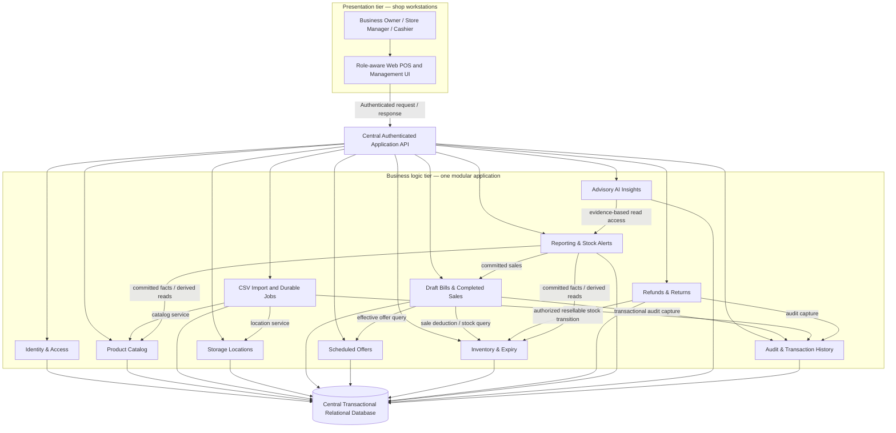

# Architecture — AI-Powered Smart POS and Inventory Management System

**Document status:** Architectural specification; design decisions recorded as Proposed in ADR-001–ADR-005 (not a claim of formal approval)  
**Architecture baseline:** `PRD.md` (FR-01–FR-16, NFR-01–NFR-04), ADR-001–ADR-005  
**Decision status:** The referenced ADRs are Proposed. This document consolidates the selected architectural direction; it does not imply that proposed ADRs, deployment conditions, technologies, or unresolved product rules have received final approval.

## 1. System Overview

The AI-Powered Smart POS and Inventory Management System supports the in-store operations of **one retail shop**. Its users are the Business Owner, Store Manager, and Cashier. It brings together product lookup and maintenance, checkout, inventory and expiry information, refunds and returns, CSV product import, product storage locations, scheduled store-wide offers, sales reporting, stock alerts, audit/history, and advisory AI Insights.

The system is logically organized into three tiers:

1. **Presentation tier:** A role-aware web POS and management interface used from shop workstations.
2. **Business logic tier:** One centrally hosted application/API containing cohesive business modules. Modules communicate through explicit in-process application-service interfaces.
3. **Persistence tier:** One central transactional relational database. Modules have logical ownership of their data and repositories; cross-module operations are coordinated by application services rather than unrestricted table access.

The application server is the trust boundary. Workstations do not connect directly to the database. The proposed deployment is a central shop-hosted server accessed over a controlled shop network, potentially a LAN. This is a working deployment choice, not a confirmed network, offline, availability, or hardware requirement; those remain subject to PRD OQ-27.

### Scope boundaries

- In-store transactions for one shop only; no multi-branch synchronization or e-commerce.
- Payment is received and verified outside the POS. The POS records a sale only after an authorized user pushes the bill; it does not process payments or connect to a payment provider.
- A Draft Bill is not a Completed Sale and does not reserve or deduct stock. It is persisted only when the Cashier explicitly saves it.
- No supplier management, purchase orders, supplier ordering, delivery tracking, online ordering, customer accounts, or loyalty scheme.
- AI Recommendations are advisory. They do not make the Business Owner's purchasing decision or place supplier orders.

## 2. Architectural Goals and Drivers

The architecture is shaped by the following goals:

- Preserve consistency between Completed Sales and inventory deductions, including retries and interruption recovery.
- Enforce role permissions centrally on the server for every protected operation and read.
- Keep routine checkout operations within the stated three-second response-time target, verified against the NFR-01 profile (at least 95% of measured operations, five concurrent users, documented development machine).
- Keep business capabilities cohesive and independently understandable without introducing unnecessary distributed-system complexity.
- Support large, staged, recoverable CSV imports without blocking checkout or modifying stock quantities.
- Maintain normalized current product-location assignments and safely handle location deletion.
- Apply store-wide scheduled offers according to authoritative time at bill calculation and final Push.
- Isolate reports, alerts, and AI processing from transaction-critical checkout.
- Preserve traceability for sales, refunds, and sensitive changes while keeping unresolved retention rules open.

### 2.1 Architectural style selection

**Selected proposed style:** Three-tier client–server, layered modular monolith.

This style combines separation of presentation, application/domain logic, and persistence with modular decomposition by business capability. A single application deployment and shared transactional database make cross-module operations—especially sale and stock updates—straightforward to coordinate atomically. In-process service calls avoid unnecessary network hops in the checkout path.

The following alternatives were considered and not selected for the current scope:

- **Independently deployed microservices:** add network, deployment, observability, and distributed-transaction complexity not justified by a one-shop system.
- **Two-tier workstation-to-database:** spreads business rules and database access across clients and weakens the central security boundary.
- **Primarily event-driven/distributed architecture:** asynchronous processing is useful for background work but is unsuitable as the authority for completing a sale and deducting stock.

The modular monolith is one deployment unit, not one undifferentiated business-logic component. Module boundaries and explicit service contracts remain mandatory.

## 3. Architecture-Significant Requirements (ASRs)

The PRD classifies only selected architecturally significant NFRs as ASRs. Functional requirements and constraints below are architectural drivers, not additional ASRs.

| ID | Source | Architectural significance and response |
|---|---|---|
| **ASR-01 — Transaction and inventory consistency** | NFR-02 | A Completed Sale must have its corresponding stock deduction exactly once. Use one server-controlled database transaction, idempotent Push operation identifiers, integrity constraints, and concurrency controls. Refund recovery details remain open. |
| **ASR-02 — Role-based access enforcement** | NFR-03 | Business Owner, Store Manager, and Cashier have materially different permissions. Enforce authorization centrally at the application API and in owning business services; UI hiding is not a security control. |
| **ASR-03 — Routine POS response time** | NFR-01 | Barcode recognition, item addition, Draft Bill recalculation, and Push each have a maximum three-second target, verified when at least 95% of measured operations meet it with five concurrent users on a documented development machine. Keep checkout synchronous work bounded and indexed; analytics/AI response targets remain open (OQ-23). |

**Important NFR not promoted to an ASR:** NFR-04 (usability) remains applicable, with a defined test profile (five participants across all three roles, one hour of training, at least 90% completing their role's tasks unaided), but it creates no architecture-level constraint.

### 3.1 Additional architectural drivers

- **FR-14 — CSV Product Import:** exact schema validation, row-level rejection, duplicate resolution before existing-product matching, Replace/Skip choices, explicit confirmation, durable progress, idempotent row writes, and up to three retries after the initial attempt. Stock quantities must not change.
- **FR-15 — Storage Location Management:** each product has zero or one current location; normalization, filtering, role control, and atomic unassignment on confirmed deletion are required.
- **FR-16 — Scheduled Authorized Offers:** store-wide percentage/fixed-amount offers must not overlap; effective eligibility is evaluated at precise start/end boundaries and again at Push.
- **FR-11/FR-12 — Refunds and returned stock:** refunds link to original sales and units; returned products do not become Available Stock until the Business Owner or Store Manager confirms them Resellable. The Cashier submits refund requests; the Owner/Manager approves or rejects them (Pending → Approved → Refunded, or Pending → Rejected), and cumulative refunds cannot exceed the original amount paid. Handling of failed external refund reversals and some reporting rules remain open.
- **FR-13 — Transaction History and Audit Records:** committed sales/refunds and sensitive actions require traceability and role-controlled access; retention/deletion details remain open.
- **FR-10 — Explained AI Recommendations:** recommendations use available evidence, explain uncertainty, and must not fabricate missing information or interfere with checkout.
- **FR-04 and CON-03/CON-06:** external payment verification and Push define the sale boundary; no payment gateway or stock reservation workflow. Insufficient stock rejects the Push and leaves the Draft Bill unchanged; concurrent pushes for the last unit allow only one commit.
- **CON-01/CON-02:** single-shop, in-store scope; no multi-branch or online-ordering architecture is required.

## 4. Logical Architecture and Diagram



**Diagram interpretation:** All business modules execute in the same backend deployment. Arrows show logical service dependencies and controlled persistence access, not permission for arbitrary cross-module table writes. The UI never accesses the database. The API establishes authenticated identity context; owning modules enforce their own business invariants as well as the central role policy. The database is not an unrestricted inter-module message bus.

## 5. Major Components and Boundaries

### 5.1 Presentation tier

**Responsibilities:** Login and role-aware navigation; checkout and product lookup; product/inventory management screens; CSV upload, preview and decision workflow; location management; offer scheduling; refund handling; permitted reporting, alerts, AI Insights, and audit/history views.

**Boundary:** Owns transient presentation state only. It does not own authoritative business rules, trusted role decisions, transaction state, or database credentials. It calls the authenticated application API and displays server-authoritative results. Hiding controls improves usability but never replaces server authorization.

### 5.2 Identity & Access

**Responsibilities:** Authenticate users, maintain the three defined roles, expose a consistent permission-check boundary, and support Business-Owner-only user administration/password resets.

**Data ownership:** Users, role assignments, credentials and relevant session-related records.

**Boundary:** Every protected API operation/read passes through server-side authorization. The owning module also checks critical business permissions where appropriate. Login is required when the system starts and no automatic inactivity lock/logout is required (PRD FR-01). Authentication mechanism, credential/session format and remaining permission details (OQ-02) are not fixed by the ADRs; password/lockout policy is recorded as unnecessary for the stated LAN context, subject to OQ-27.

### 5.3 Product Catalog

**Responsibilities:** Register and maintain product identity, barcode, product name, selling price, category and product metadata; perform barcode/manual-barcode/name lookup; support authorized product maintenance and CSV replacement.

**Data ownership:** Product records, barcode identity/uniqueness, selling price, and the product's nullable current location reference (with location assignment governed through the Locations service).

**Boundary:** Does not own stock quantities, expiry/batch balances, refund state, or offer schedules. CSV import must not bypass Catalog's service contract or modify stock. Catalog owns the **product row**, including its nullable Storage Location reference, and is the **only module whose repository updates that row**. Locations owns the validation and lifecycle of location records; it requests product assignments/unassignments through a public Catalog port within the caller's shared unit of work.

### 5.4 CSV Import

**Responsibilities:** Stream uploaded CSV files; validate the exact ordered header `product_name,barcode,selling_price,storage_location`; validate rows; persist staging; collect duplicate-row choices; collect Replace/Skip decisions; provide a complete/paginated preview; require explicit final confirmation; process eligible rows; and produce a durable outcome report.

**Data ownership:** Import jobs, staged rows, validation errors, duplicate groups and decisions, immutable confirmed choices, retry/progress markers, and per-row outcomes.

**Boundary:** Only Business Owner and Store Manager can import. No Product or Storage Location mutation occurs during preview. After confirmation, the worker calls Catalog and Locations services. Each row's product mutation, optional location operation, and success marker are committed together. A failed row is retried up to three times after the initial attempt; successful rows are not replayed. No import changes stock quantities. Within-file duplicate resolution occurs before matching retained rows to existing products.

**Worker and data-integrity boundary:** CSV Import owns **one authoritative business job/row state machine** (staging, decisions, claims/progress, outcome, retries). A generic infrastructure worker may provide execution/lease mechanics but **must not introduce a second competing business status**; for this single workload, a separate general job engine is optional, not mandated. Confirmation and its immutable decisions are checked by the server against the authenticated user's permissions. Background execution uses persisted server-created job identity, actor attribution and authorization evidence, not a browser-supplied role; what to do after subsequent user deactivation/role revocation remains an explicit policy gate, not an assumed behavior. On each commit, re-check barcode uniqueness and the identity/version of an existing-product match; stale Replace/Skip decisions must not silently modify a different product. Restrict worker concurrency, memory use, and database connections so imports cannot starve checkout.

### 5.5 Storage Locations

**Responsibilities:** Create, normalize, find, assign, reassign, delete, and filter by current Storage Location. Normalize only capitalization and minor formatting variations; do not fuzzy-correct genuine spelling differences.

**Data ownership:** Canonical Storage Location records and location lifecycle/assignment rules. The product stores a nullable reference to its one current location.

**Boundary:** A product has zero or one current location. Owner and Manager may manage locations and assignments; Cashier may view a product's current location during permitted lookup only. Confirmed deletion atomically unassigns all affected products and deletes the location without deleting products or assigning replacements. No location-movement history is required. **Locations must not issue SQL that updates Catalog's product table**: it invokes Catalog's public bulk-unassign/assign operation inside the same transaction, then deletes its owned location record. A database referential-integrity action is a defensive safeguard, not permission to bypass the owning Catalog service. The application-level product-search composer combines Catalog lookup with a Locations current-location read; **location filtering is a separate Owner/Manager-only query**, never exposed to Cashiers.

### 5.6 Draft Bills & Completed Sales (Billing)

**Responsibilities:** Prepare and save Draft Bills, calculate bill amounts using applicable current offer terms, re-evaluate authoritative prices/quantities/offer at Push, record Completed Sales, and coordinate the corresponding inventory deduction and required audit capture.

**Data ownership:** Draft Bill and Completed Sale headers/lines, operation identifiers, and immutable sale-line price/offer snapshots.

**Boundary:** A Draft Bill is not a Completed Sale, does not appear as one in Transaction History, and does not reserve or deduct stock. Push occurs only after payment has been received and checked outside the POS; the Business Owner, Store Manager and Cashier may each Push. Push is the authoritative transaction boundary: sale, stock deduction and required traceability commit together or not at all. Use a stable unique operation identifier so retries cannot duplicate a sale or deduction. **One logical Push retains the same identifier through network retries/reloads, and the server binds it to the same authorized request and outcome**; a reused identifier with changed bill content must not execute a second write. The identifier origin/persistence mechanism is detailed design, not permission to create a fresh identifier for a retry. Apply database concurrency controls: a requested quantity above Available Stock rejects the Push with no Completed Sale or deduction and leaves the Draft Bill unchanged, and for concurrent pushes of the last unit only one commits while the other cashier is asked to refresh the stock and retry (PRD FR-04). **A Draft Bill is persisted only when the Cashier explicitly clicks Save; an unsaved draft is lost if the system crashes, and a saved draft is still neither a Completed Sale nor a stock reservation.**

### 5.7 Scheduled Offers

**Responsibilities:** Manage store-wide Authorized Offers of Percentage Discount or Fixed-Amount Discount; validate start/end intervals; prevent overlap; expose current effective offer terms to Billing; support authorized edits/cancellation.

**Data ownership:** Offer terms, start/end instants and cancellation state.

**Boundary:** Only Owner and Manager may create/edit/schedule/cancel. Offers apply store-wide, not to selected products. Effective eligibility is computed on the server using `start <= now < end` and cancellation state; it is not trusted from a client clock or a scheduler-maintained active flag. Schedule writes must serialize/check overlaps transactionally. Billing evaluates at calculation and again at Push; a Completed Sale retains the applied snapshot and is never retroactively repriced. Pakistan Standard Time (PKT) is the canonical store timezone, and percentage and fixed-amount discounts are calculated from the bill subtotal (never exceeding it). Clock synchronization/precision (OQ-51) and currency, tax, rounding and calculation order (OQ-50) remain open.

### 5.8 Inventory & Expiry

**Responsibilities:** Own Recorded Stock/Available Stock rules, stock balances and movements, authorized manual adjustments, Product Batch data, and sale/return-driven stock changes. Provide authoritative stock queries and operations to Billing and Refunds & Returns.

**Data ownership:** Stock quantities/balances, stock movements, and Product Batch records (each with its own quantity, Expiry Date and purchase cost per unit).

**Boundary:** Catalog does not write stock. Billing invokes the Inventory service for the sale deduction within the Push unit of work. CSV import cannot change stock. Returned items remain separate from Available Stock until the required authorized resellability decision. When Recorded Stock and physical/Available Stock disagree, the discrepancy is presented and the Owner/Manager chooses the resolution through an authorized adjustment; nothing is silently auto-corrected. The exact relationship between Recorded and Available Stock and adjustment validation remain open (OQ-34); refund/return recovery and reporting details remain open (OQ-13/OQ-14/OQ-24).

### 5.9 Refunds & Returns

**Responsibilities:** Validate a Receipt against a Completed Sale; enforce the 168-hour eligibility window; link full/partial refunds to original sale lines/units; prevent duplicate refunds for the same units; track refund status (Pending → Approved → Refunded, or Pending → Rejected); record returned products separately from stock eligibility.

**Data ownership:** Refund headers/lines, links to original sale and sale-line/units, refundable quantities/status, return condition/resellability decisions as those rules are finalized.

**Boundary:** Do not overwrite or erase the original sale. Monetary refund state is distinct from returned-product condition and Available Stock. The Cashier submits eligible refund requests; the Business Owner or Store Manager approves (up to the remaining refundable limit: original amount actually paid minus amounts already Pending, Approved or Refunded, with rejected requests releasing their reserved amount) or rejects them. The Cashier performs the initial inspection of returned products and the Owner/Manager makes the final resellability decision. The 168-hour boundary instant, failed/interrupted external monetary reversals, report treatment and recovery remain open (OQ-13–OQ-15/OQ-24).

### 5.10 Reporting & Stock Alerts

**Responsibilities:** Provide dashboard and sales-report read views, product performance and sales trends, and Stock Alerts for Out of Stock, Low Stock (against the manually configured product-specific threshold) and Approaching Expiry once its warning period is established.

**Data ownership:** Derived aggregates/read models and alert state where needed; source transaction and inventory records remain owned by their respective modules.

**Boundary:** Read committed facts or refreshable derived views. Derived data may briefly lag. Reports/alerts do not write authoritative sale or stock records and must not block Push. Exact metrics, periods, formulas, thresholds and alert priorities remain open (OQ-08/OQ-09/OQ-16–OQ-21/OQ-42).

### 5.11 AI Insights

**Responsibilities:** Provide advisory, evidence-linked AI Recommendations from available sales and stock information; explain evidence and uncertainty; report Insufficient Data rather than fabricate missing facts; suggest advisory Low Stock thresholds that never replace the manual threshold unless an authorized user accepts them.

**Data ownership:** Recommendation snapshots/evidence references only if retention is chosen; source facts remain owned by Catalog, Inventory, Billing and Reporting.

**Boundary:** Read-oriented and isolated from checkout. AI failure or latency cannot roll back or block a valid Completed Sale. No model, provider, prediction method, numerical accuracy target, third-party data transfer, or automatic purchasing is selected. Any external provider requires a new architectural decision and data-exposure review.

### 5.12 Audit & Transaction History

**Responsibilities:** Capture sensitive committed actions with actor, timestamp, action and relevant previous/new values; provide role-restricted Audit Records and a controlled Transaction History view over Completed Sales and linked refund records.

**Data ownership:** Durable audit records. Original sale and refund records remain owned by Billing and Refunds & Returns; this module presents their history rather than becoming an alternate transaction writer.

**Boundary:** Audit writes are server-side and associated with the relevant transaction where consistency requires it. **The Audit write module must not import Billing or Refunds & Returns:** those use Audit's append port. A **read-only Transaction History composition at the application/API layer**, using public Billing, Refunds & Returns and Audit query ports, presents combined history without an Audit↔Billing dependency cycle or a new persisted source of truth. Owner deletion authority, retention, deletion safeguards, and some history details remain open (OQ-04/OQ-35).

## 6. Interfaces and Interactions

| From | To | Interface / interaction | Key rule |
|---|---|---|---|
| Workstation UI | Application API | Authenticated request/response | No direct DB connection; server decides permissions. |
| API | Identity & Access | Authentication and permission policy | Every protected operation/read is checked server-side. |
| Billing | Offers | Effective offer query at server time | Re-evaluate at calculation and Push; persist applied snapshot. |
| Billing | Inventory | Stock query and sale deduction | Sale and deduction share the authoritative Push transaction. |
| Billing | Audit | Transactional audit capture | Required traceability commits with the business operation. |
| CSV Import | Catalog | Product create/replace and lookup service | Import decisions resolved before writes; stock untouched. |
| CSV Import | Locations | Canonical location lookup/create/assignment | Location changes occur only after confirmation and within row commit. |
| Locations | Catalog public application service | Owner-authorized assignment/bulk unassignment in the caller's unit of work | **Only Catalog's repository writes product rows**; one nullable location reference; deletion is atomic. |
| API-level product-search composer | Catalog + Locations public read ports | Combine product identity with current location for permitted lookup | Cashier may **view** current location; only Owner/Manager can use filter-by-location. |
| API-level Transaction History query composer | Billing + Refunds & Returns + Audit read ports | Compose permitted sale/refund/audit history without new storage | Audit writer does **not** depend on Billing/Refunds. |
| Refunds & Returns | Billing | Verify original Completed Sale and sale lines | Refunds link to original transaction; original sale is preserved. |
| Refunds & Returns | Inventory | Return/resellable stock transition | Returned quantity is not sellable until authorized resellability confirmation. |
| Reporting & Alerts | Billing / Catalog / Inventory | Read committed facts or derived views | No authoritative checkout writes; derived views may lag. |
| AI Insights | Reporting and committed domain facts | Evidence-based read interface | Advisory only; failures isolated from checkout. |

### 6.1 Communication patterns

- **Synchronous:** UI-to-API request/response and in-process application-service calls for checkout, authorization, offer evaluation and other immediate business operations.
- **Transactional:** A single application-layer unit of work over the central relational database for operations that must be indivisible, especially Push and row-level confirmed import operations.
- **Asynchronous/durable background work:** CSV import processing and non-critical report/AI read-model refreshes may use durable jobs. Jobs must be restartable/idempotent and must not become the source of truth for sale completion, stock deduction, or offer eligibility.
- **Post-commit notifications:** May be used for non-critical refresh work after authoritative state has committed. No external notification service is required by the current scope.

### 6.2 Ownership-safe transaction and dependency contracts (review clarification)

The central database is shared for **ACID atomicity**, not for unrestricted SQL access. An application-level **opaque unit-of-work handle** can be passed to public module operations when multiple modules must commit together. This handle permits the module's own repository to join the transaction; it **does not expose a raw database connection or arbitrary SQL capability** to callers. Only the relevant module's persistence adapter can write its owned tables. DB foreign keys can cross ownership boundaries as integrity constraints without authorizing foreign writes.

| Workflow | Coordinator and called public ports | Non-negotiable transaction rule |
|---|---|---|
| **Push / Completed Sale** | Billing → Catalog product/price read, Offers current terms, Inventory stock deduction, Audit append | One transaction for sale, deduction and required audit; stable logical-Push identity; never a background commit. |
| **Delete Storage Location** | Locations → Catalog bulk-unassign port → Locations delete | Catalog alone updates product references. Both effects commit together, preserving products. |
| **Confirmed CSV row** | CSV Import → Catalog product write + Locations create/resolve/assignment services | One row transaction includes product mutation, optional location operation and durable success marker. Revalidate stale preview before writes. |
| **Transaction History read** | API-level query composer → Billing/Refunds/Audit public reads | Read composition only; Audit writer never calls into Billing/Refunds (acyclic dependencies). |
| **Product lookup with current location** | API-level query composer → Catalog lookup + Locations current-location port | Cashier sees current location only during authorized lookup; filter-by-location remains Owner/Manager-only. |

**Dependency direction:** Business-use-case coordinators depend on capability public contracts; `Audit` exposes append/read ports but never imports its callers. Infrastructure utilities do not import business modules. The client calls only the authenticated API. Avoid a new service or module solely to implement the two API-level read compositions.

**Durable work authorization:** Authenticate and authorize CSV upload, decision changes and confirmation. On confirmation persist server-attested actor identity, immutable selected rows/Replace-Skip decisions and an auditable job identity. A worker accepts only server-managed confirmed work and runs it under a bounded internal capability, never under a role declared in client data. Treatment of jobs after the initiator is disabled or loses authorization must be determined by the team before implementation; the architecture does not silently select revalidation-versus-continuation policy.

**Work separation and the performance budget:** NFR-01 specifies **3 seconds for each** barcode recognition, adding an item, Draft Bill recalculation and Push, verified when at least 95% of measured operations meet it with five concurrent users on a documented development machine. No capacity target is defined beyond that profile. Bulk imports and report/AI refreshes must not monopolize CPU, memory, database connections or locks needed for checkout. Contention/load testing is required before claiming the target is met.

**Pending details, not architectural choices:** Draft Bill resume/Confirm behavior beyond the explicit Save, client-to-server idempotency token transport, exact stale-preview user message, role-revocation treatment for already confirmed imports, physical database schema-per-module, and choices of runtime/tooling are **not decided** by this clarification.

## 7. Important Data Responsibilities

| Data group | Logical owner | Authority and integrity expectations |
|---|---|---|
| Users, roles, credentials/sessions | Identity & Access | Central identity and policy; only Owner administers users. No automatic inactivity lock/logout is required; credential/session format remains open. |
| Product identity, barcode, name, selling price | Product Catalog | Relational records; enforce barcode uniqueness. No stock ownership. |
| Storage Locations and current assignment | Locations + Catalog | Separate normalized location entity; nullable current product reference; zero or one location. |
| Stock, movements and expiry/batches | Inventory | Authoritative quantities and inventory changes; each Product Batch keeps its own quantity, Expiry Date and purchase cost; definitions of Available vs Recorded Stock remain open. |
| Draft Bills and Completed Sales | Billing | Distinguish drafts from completed transactions; a draft is persisted only on explicit Save; stable Push idempotency key; retain applied price/offer snapshots. |
| Scheduled Authorized Offers | Offers | Store-wide interval and discount terms; serialized overlap-safe writes; effective status derived from server time. |
| CSV staging and outcomes | CSV Import | Durable job/row state, user decisions, retry markers and outcome report. |
| Refunds and returns | Refunds & Returns | Linked to original sale/units; monetary status (Pending/Approved/Refunded/Rejected) distinct from resellability/stock eligibility. |
| Audit records | Audit | Actor-stamped, server-written traceability; retention/deletion policy open. |
| Reports, alerts and recommendations | Reporting / AI Insights | Derived/read-oriented; source facts remain authoritative in owning modules. |

## 8. External Systems and Services

**No external business service is required by the current architecture.**

- **Payment provider:** explicitly not integrated. Staff verify payment outside the POS.
- **Supplier, purchase-order, delivery, shipping or e-commerce systems:** out of scope and not integrated.
- **Customer identity, loyalty, external SSO:** not required.
- **Email/SMS/push notification service:** not required by the supplied requirements.
- **Third-party AI/model API:** not selected or required. A future provider requires human approval, an ADR, and review of data exposure and security boundaries.
- **Barcode scanner:** treated as an input peripheral. No device model or scanner protocol is mandated.
- **Relational database:** a required architectural persistence capability, but no database vendor/product is selected.

## 9. Architectural Constraints and Invariants

1. Maintain the three-tier logical separation and one modular backend deployment unless an approved ADR changes it.
2. Workstations must call the authenticated application API; never connect a browser/client directly to the database or expose DB credentials.
3. Enforce permissions server-side on every protected operation and sensitive read. UI hiding is not authorization.
4. Preserve exactly three roles: Business Owner, Store Manager, Cashier. Do not invent a fourth role; “Authorized Inventory User” means Owner or Manager.
5. Keep Catalog, Inventory, Offers, Billing, Refunds, Locations, Import, Reporting/AI and Audit responsibilities separate. Cross-module work uses explicit application-service contracts, not arbitrary table writes.
6. Push is the only agreed Completed Sale boundary. A Draft Bill is not a sale, does not reserve or deduct stock, and is persisted only on explicit Save.
7. Sale, corresponding stock deduction and required traceability commit atomically; Push retries must be idempotent and concurrency-safe.
8. Do not move sale/stock correctness to a background job or eventual-consistency workflow.
9. CSV import requires the exact ordered four-column header; storage_location is optional per row. Preview must not mutate Product or Location records. Import must never change stock quantity.
10. CSV duplicate groups are resolved before matching retained rows to existing products. Existing matches require Replace/Skip. Confirmed row processing is durable, idempotent, and retries a failed row up to three times after its initial attempt.
11. Product location is zero or one current assignment. Confirmed location deletion unassigns products atomically; it does not delete products, auto-reassign, or create location history.
12. Offers are store-wide and non-overlapping. Eligibility uses server-authoritative time and a start-inclusive/end-exclusive interval; evaluate again at Push. Do not trust client time or a scheduled active flag.
13. Keep refunds and returns linked to original sales. The Cashier submits refunds; the Owner/Manager approves or rejects them. Do not conflate refund status with returned-product resellability or Available Stock.
14. Reporting and AI consume committed facts/derived views; they cannot block, roll back, or alter a valid sale. AI remains advisory and cannot place orders.
15. Do not introduce microservices, a message broker, external provider, cloud dependency, payment integration, or independent data store without an approved ADR.
16. The architectural context does not select a programming language, UI/server framework, ORM, database vendor, AI model, cloud provider, hardware or final hosting topology. Any future technology choice is recorded separately if it materially changes the architecture; there is no technology-stack ADR in this package.
17. Treat LAN hosting as provisional. Do not assume offline billing, high availability, 24/7 availability, backup schedule, RPO, RTO, or recovery targets until OQ-27 is resolved.
18. Keep checkout work bounded and indexed to support the three-second NFR-01 target; do not invent workload or throughput guarantees beyond the NFR-01 test profile.

## 10. Unresolved Decisions and Explicit Non-Decisions

The architecture deliberately leaves the following PRD questions unresolved. Implementation must preserve extension points and avoid hard-coding assumptions until the product owner/team decides them.

| Open question(s) | Unresolved topic |
|---|---|
| OQ-02 | Remaining role permissions outside the defined role matrices. |
| OQ-04 | Owner audit deletion, retention and deletion safeguards. |
| OQ-08/OQ-09/OQ-39 | Approaching Expiry warning period, expiry-date validation, AI-suggested Low Stock threshold method and alert priority. |
| OQ-10/OQ-31/OQ-50 | Manual-discount exceptions, tax/currency/rounding and remaining calculation-order details. |
| OQ-13–OQ-15/OQ-24/OQ-35 | Failed/interrupted external refund reversals, report treatment of refunds/returns, 168-hour boundary instant, crash recovery and refund-specific history permissions. |
| OQ-16–OQ-21/OQ-42 | Reporting periods, metrics, filters, sales trend/demand/profit formulas and dashboard figures. |
| OQ-22/OQ-43 | AI recommendation evidence, algorithm/provider, timing and correctness criteria. |
| OQ-23 | Response-time targets for report generation, Stock Alerts and AI Recommendations. |
| OQ-27 | Hardware, network, deployment, offline behavior, availability, backup and recovery objectives. |
| OQ-34 | Recorded Stock vs Available Stock relationship and stock-adjustment validation (negative quantities, concurrency). |
| OQ-51 | Server clock synchronization/precision and time-boundary test specification (PKT is the canonical store timezone). |
| FR-14.1/FR-14.6 | CSV field validation formats, representative file sizes/workload and performance benchmarks. |
| Architecture decision gate (not yet resolved by PRD) | Technology selection; worker behavior after role revocation; detailed idempotency-token transport. Preserve these as open implementation/approval gates, not newly approved product rules. |

The list is a navigation summary, not a replacement for the full Open Questions section of the authoritative PRD. Where a question is not listed here, consult PRD Section 14 before making a product or implementation decision.

## 11. Architectural Validation Guidance

The following checks validate architectural properties; they are not claims that tests have already passed:

- **ASR-01:** interrupt Push at multiple points; retry the same operation; verify no sale without its stock deduction and no duplicate deduction. Test concurrent attempts against constrained stock: only one last-unit Push commits, the other receives the refresh-and-retry message and its Draft Bill stays unchanged.
- **ASR-02:** invoke protected API operations directly as each role; verify prohibited actions and reads are denied regardless of UI state.
- **ASR-03:** measure barcode recognition, item addition, bill recalculation and Push separately against the three-second target under the NFR-01 profile (at least 95% of measured operations, five concurrent users, documented development machine).
- **CSV import:** test exact-header rejection, invalid rows, duplicate groups, Replace/Skip ordering, no preview writes, row retries, restart recovery, complete outcome reports and no stock changes.
- **Locations:** test normalization, one-current-location integrity, confirmed/cancelled deletion, atomic unassignment, product preservation and filter invalidation.
- **Offers:** test adjacent and overlapping intervals, concurrent schedule writes, start-inclusive/end-exclusive boundaries, active edits, cancellation, stale drafts and final Push re-evaluation.
- **Refunds/returns:** test sale linkage, duplicate-unit prevention, the remaining refundable limit, Pending → Approved → Refunded and Pending → Rejected transitions, Owner/Manager-only approval, and refund/return state separation and stock transition.
- **Isolation:** make reporting/AI unavailable or slow and verify valid checkout still completes; verify AI never writes stock or initiates purchasing.
- **Ownership and dependency graph:** prove only Catalog writes product records; Location deletion orchestrates Catalog's public bulk unassign in one unit of work; verify no Audit→Billing/Refunds imports and no raw database client travels through public service contracts.
- **Import-worker security and performance:** verify only server-confirmed immutable jobs run, actor attribution is durable, stale previews are rechecked, completed rows are not replayed, and large imports do not exhaust checkout CPU/DB/connection capacity.
- **Document/decision consistency:** confirm a single canonical PRD path; validate that architecture, AGENTS and ADR links resolve; treat all Proposed ADRs as unapproved until the team's decision is documented.

## 12. Initial Repository Structure and Architectural Boundaries

The following is the **logical source layout** used for the initial project structure. It expresses architecture and dependency rules, not a mandatory runtime or database product. A module starts with a public interface, service and repository; add internal folders only when justified by complexity.

```text
smartpos/
├── PRD.md
├── architecture.md
├── AGENTS.md
├── ADRs/
│   ├── ADR-001-architecture-style.md
│   ├── ADR-002-data-persistence.md
│   ├── ADR-003-authentication-boundary.md
│   ├── ADR-004-csv-import-recovery.md
│   └── ADR-005-scheduled-offer-eligibility.md
├── client/
│   └── src/
│       ├── app/                 # navigation, role-aware presentation
│       ├── api/                 # server request client; no DB access
│       └── features/            # domain-aligned presentation features
├── server/
│   ├── infrastructure/
│   │   ├── db/                 # shared connection/transaction plumbing only
│   │   ├── unit-of-work/       # opaque multi-module transaction coordination
│   │   └── clock/              # consistent server-side offer-time source
│   ├── api/
│   │   ├── routes/             # thin authenticated request handlers
│   │   └── composers/
│   │       ├── product-search/  # Catalog and Locations read ports
│   │       └── transaction-history/ # Billing, Refunds and Audit read ports
│   └── modules/
│       ├── identity-access/
│       ├── catalog/
│       ├── csv-import/
│       ├── storage-locations/
│       ├── billing/
│       ├── offers/
│       ├── inventory/
│       ├── refunds-returns/
│       ├── reporting-alerts/
│       ├── ai-insights/
│       └── audit/
└── tests/                       # boundaries and requirements verification
```

### 12.1 Minimum module contract

Each server module exposes a **public service interface**, encapsulates its business rules, and delegates persistence operations to its own repository. Modules cannot import another module's private repository, issue SQL against another module's tables, or pass unrestricted database connections across their public interfaces. A shared transaction is represented by an **opaque unit-of-work handle**. Physical database schemas and language-specific file extensions are not imposed by the architecture.

### 12.2 Allowed coordination and dependency direction

| Coordinator | Allowed public interfaces | Scope and ownership guard |
|---|---|---|
| **Billing** | Catalog product/pricing reads; Offers active terms; Inventory deduction; Audit append | Push is synchronous and commits sale, deduction and required audit atomically. |
| **Storage Locations** | Catalog assign/bulk-unassign product reference | Only Catalog writes product rows; Locations owns location lifecycle, normalization and authorization of location management. |
| **CSV Import** | Catalog create/replace; Locations resolve/create/assign; Audit append | Durable import state remains in CSV Import; confirmed row effects and success marker share a transaction. |
| **Refunds & Returns** | Billing sale verification; Inventory authorized return-to-stock operation; Audit append | Money-refund status and product-resellability status remain distinct. |
| **Reporting & Alerts** | Catalog, Inventory, Billing and Refunds read contracts | Read-only reporting; never write authoritative transactional facts. |
| **AI Insights** | Reporting evidence/read contract | Advisory outputs only; no direct stock, sale or supplier-order writes. |
| **Application API composers** | Product Search: Catalog + Locations; Transaction History: Billing + Refunds + Audit | Compose read results without creating a cross-domain owner or cyclic dependency. |
| **Any protected endpoint** | Identity & Access permission policy | The server validates both interactive and sensitive read permissions. |

**Audit** only provides append and authorized read ports. Audit must not import Billing or Refunds. **Infrastructure** imports no business module. The optional in-process CSV worker executes only confirmed immutable jobs; it is not another service, message broker, independent database or second authoritative import-status store.

### 12.3 Repository and implementation constraints

- The `client/` and `server/` separation describes the UI and server responsibilities; deployment remains one modular backend application with optional co-hosted static UI.
- Keep the project skeleton small. Separate schemas per module, a general-purpose job platform, external schedulers and additional frameworks are not required architecture components.
- Persist a Draft Bill only on an explicit Save; do not assume a specific table design or Resume behavior beyond that. Do not commit to an idempotency-token transport mechanism before its decision.
- Resource-bound import processing must not starve the synchronous checkout workload. NFR-01 retains the three-second target, tested under its five-concurrent-user profile.
- A selected language, framework or relational database vendor may be documented by the team separately; the five ADRs in this package are technology-neutral.

## 13. Architecture Decision Records

The following five decision records establish the architectural direction and its trade-offs. Their status is **Proposed**, pending a separately recorded approval decision.

- [ADR-001 — Three-Tier Layered Modular Monolith](ADRs/ADR-001-architecture-style.md)
- [ADR-002 — Central Relational Persistence and Atomic Sale/Stock Commit](ADRs/ADR-002-data-persistence.md)
- [ADR-003 — Central Authentication and Server-Enforced Role Authorization](ADRs/ADR-003-authentication-boundary.md)
- [ADR-004 — Staged, Resumable CSV Product Import](ADRs/ADR-004-csv-import-recovery.md)
- [ADR-005 — Server-Authoritative Scheduled Offer Eligibility](ADRs/ADR-005-scheduled-offer-eligibility.md)

**Document authority:** `PRD.md` defines product behavior and open questions; `architecture.md` defines logical structure, responsibility boundaries and interfaces; the ADRs record major alternatives, choices and consequences; `AGENTS.md` specifies operational constraints for maintaining those decisions.
