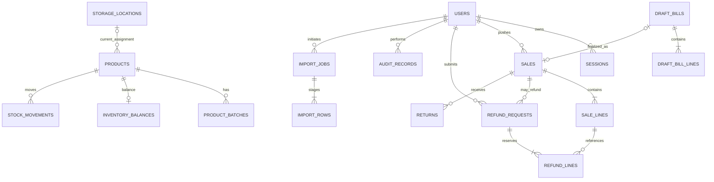

# SmartPOS — Logical PostgreSQL Data Model

**Status:** Approved Stage 2 logical design; migrations are **not implemented**. This document proposes logical tables and constraints for slice-level migrations. It is not evidence that a database exists.

## Cross-cutting conventions

- UUID primary keys for domain records; `timestamptz` stored as UTC instants. Convert presentation/reporting boundaries using `Asia/Karachi` (PKT).
- Money uses integer PKR paisa (`bigint`) for exact arithmetic; expose formatted PKR and decimal input only at API boundaries. A migration/contract must document this representation.
- Barcode is `text`, preserves leading zeros, and has a unique constraint under the approved normalization policy. Do not numeric-coerce.
- `created_at`, `updated_at` and actor attribution are explicit where appropriate. Audit records are append-only for ordinary app roles.
- Use foreign keys and check constraints. Cross-module reads/writes go through owning repositories; relational FKs do not authorize foreign writes.
- SQL migrations are version controlled, incremental and reversible where safe.

## Logical entities and ownership

| Entity | Owner | Key fields and constraints |
|---|---|---|
| `users` | Identity & Access | id, username, password_hash, role enum, active, timestamps; normalized unique username |
| `sessions` | Identity & Access | id, user_id FK, opaque session hash, expiry, created_at; revoke on logout/deactivation/credential changes |
| `products` | Catalog | id, barcode text unique, name, category, selling_price_paisa >= 0, location_id nullable FK, timestamps, version |
| `storage_locations` | Locations | id, canonical_name, normalized_key unique, timestamps, active/deleted state as needed |
| `inventory_balances` | Inventory | product_id PK/FK, recorded_qty >= 0, version; Available Stock derived from eligible inventory/return state, not client-written |
| `product_batches` | Inventory | id, product_id FK, received_qty > 0, remaining_qty >= 0, expiry_date nullable only for explicitly non-expiring products, unit_cost_paisa >= 0, received_at, non_expiring flag; expiry/non-expiry check |
| `stock_movements` | Inventory | id, product_id, batch_id nullable, signed quantity delta, kind, reason, actor_id, created_at, source reference/idempotency; append-oriented |
| `draft_bills` | Billing | id, actor_id, status, saved_at nullable, version, created_at; only explicit Save persists; not a stock reservation |
| `draft_bill_lines` | Billing | id, draft_bill_id, product_id, quantity > 0, calculated display snapshots as defined; mutable until Push |
| `sales` | Billing | id, receipt_number unique, actor_id, draft_bill_id, idempotency_key unique, request_digest, amount_paise >= 0, completed_at, status; immutable final snapshot |
| `sale_lines` | Billing | id, sale_id, product_id, barcode/name/price snapshots, quantity > 0, allocated_discount_paisa, line_total_paisa, batch allocation reference/snapshot |
| `offers` | Offers | id, type, value, start_at/end_at UTC, cancelled_at nullable, actor/timestamps; valid type/value and start < end |
| `refund_requests` | Refunds & Returns | id, sale_id, requester_id, status, amount_paisa > 0, submitted_at, approved_by, rejected_by, external_reference, refunded_at; status checks |
| `refund_lines` | Refunds & Returns | id, refund_id, sale_line_id, quantity > 0, amount_paisa; unique active reservation by sale-line-unit/quantity accounting |
| `returns` | Refunds & Returns | id, sale_id, status/inspection, disposition, inspected_by, confirmed_by, timestamps; resellability distinct from refund status |
| `import_jobs` | CSV Import | id, actor_id, status, file metadata/hash, confirmed_at, immutable decision version, progress timestamps |
| `import_rows` | CSV Import | id, job_id, source_row_number, raw/validated fields, decision, status, attempt_count, error, committed entity IDs; unique(job_id,row_number) |
| `audit_records` | Audit | id, actor_id, action, entity type/id, previous/new JSON snapshots, timestamp, request_id; append-only |

## Constraints and indexes

- `products.barcode` unique text; product name/barcode lookup indexes.
- `products.location_id` nullable FK; one current assignment maximum by construction.
- `storage_locations.normalized_key` unique; normalization policy is deterministic, not fuzzy.
- Batch `remaining_qty >= 0`, `received_qty > 0`, cost nonnegative; check expiry/non-expiring representation.
- Stock movement source/idempotency uniqueness where source operation retries must not duplicate movement.
- Sale `idempotency_key` unique and bound to actor/bill digest. A changed request under same key is rejected.
- Sale line/stock movements/audit and final offer/price snapshot committed in one transaction.
- Refund reservations must prevent duplicate unit/value use across Pending, Approved and Refunded states; rejection releases reservation transactionally.
- Import row success marker and Catalog/Locations mutations commit together; unique job/row identity.
- Offer interval overlap protected transactionally. PostgreSQL range/exclusion constraint is preferred if representation and cancellation semantics are validated; otherwise serialize offer writes and verify under transaction/lock.
- Index `sales.completed_at`, `refund_requests.refunded_at`, `sale_lines.product_id`, `stock_movements.product_id/created_at`, `product_batches(product_id, expiry_date)`, `import_rows(job_id,status)` and required report filters.

## Transaction boundaries

1. **Push:** verify idempotency and paid intent, re-evaluate product prices/offer/stock, apply batch deductions, write sale/lines/snapshots/audit and mark draft completed in one transaction. Conditional updates/row locks ensure last-unit contention has one winner.
2. **Location deletion:** Catalog public bulk-unassign plus Locations delete in one UoW.
3. **Confirmed import row:** product mutation, optional location resolution/create/assignment and row success marker together.
4. **Refund request/decision:** sale/unit verification, monetary reservation and refund status/audit commit together; external money transfer is outside the transaction/system.
5. **Resellability:** authorized return disposition plus Inventory movement and audit commit together; no stock addition before confirmation.

## ER diagram

## Migration status

This model is an approved logical design only. No migration, table or database instance has been created or tested yet. Implement only the tables required by each slice and verify migrations against PostgreSQL before acceptance.
